# Handbuch für Vorstände

Dieses Handbuch führt durch die Einrichtung und laufende Verwaltung einer Courtside-Instanz. Die
Namen von Menüpunkten und Schaltflächen stehen *kursiv*. Öffnungszeiten, Fristen und Obergrenzen
bestimmt jeder Verein selbst.

## Wer die Verwaltung sieht

Aktive Konten mit der Rolle **Administrator** können die vollständige Verwaltung öffnen. Andere
Konten sehen dort ausschließlich die *Vereinstermine*, und nur dann, wenn eine aktive Buchungskarte
eine ihrer Rollen außer *Mitglied* als verwaltende Rolle nennt oder einer ihrer Rollen das Buchen
ohne Spielerliste erlaubt. Die Liste zeigt, wofür die verwaltenden Rollen zuständig sind, das Serienformular, was die
buchenden Rollen erlauben. Ein Konto, dem keine Karte etwas davon gibt, erhält auch über eine direkt
eingegebene Adresse keinen Zugriff. Das ändern Vorstände an den Buchungskarten.

Die Seitenleiste führt oben zur Übersicht und ordnet die Verwaltung darunter in vier Bereiche:

| Bereich | Inhalt |
|---|---|
| **Verein** | Einrichtung, Vereinsprofil, Fristen und Erinnerungen, Buchungsregeln, Nachrichtentexte |
| **Anlage** | Plätze, Öffnungszeiten, Buchungskarten und Platzfüller |
| **Mitglieder** | Personen, Konten, Mitgliedsarten und Import |
| **Nachweise** | Statistik, Nutzung, Datenexport, Aufbewahrung, Änderungsprotokoll und Nachrichtenprotokoll |

Über dieselbe Leiste kehrst du zum Platzplan zurück.

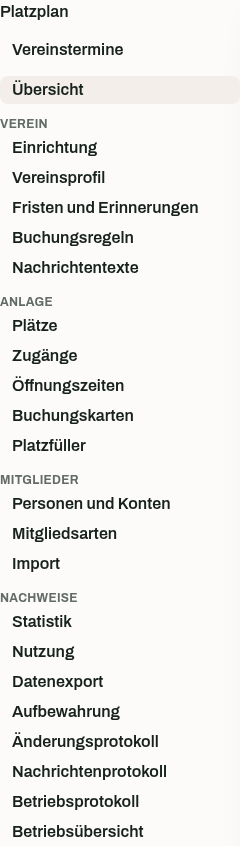

### Vereinstermine

Unter *Vereinstermine* stehen zunächst höchstens 20 anstehende Termine, der nächste zuerst. Mit
*Verlauf* wechselst du zu vergangenen und stornierten Terminen. Filtere bei Bedarf nach Platz oder
Buchungsart und lade weitere Treffer seitenweise nach. Geladene Termine derselben Serie sind
eingeklappt zusammengefasst. Der Kopf einer Serie nennt ihren ersten und letzten Termin und zählt
alle ihre Termine, auch die vergangenen und abgesagten, unabhängig davon, wie viele geladen sind.
*Details* bleibt direkt erreichbar; *Stornieren* liegt unter *Aktionen*. Neue Serien legst du am
Anfang der Seite an.

Stornierst du den Termin einer anderen Person, kannst du einen Grund wählen: Zustand des Platzes,
Wetter, Veranstaltung des Vereins, Wartungsarbeiten oder ein anderer Grund. Die Person, die gebucht
hat, und die Mitspieler erfahren den Grund. Ein Freitext ist nicht vorgesehen. Stornierst oder
verlegst du Termine einer fremden Serie, bekommt die Person, der die Serie gehört, eine einzige
Nachricht über alle betroffenen Termine.

## Die Übersicht

Die Verwaltung öffnet mit der *Übersicht*. Sie zeigt die heutigen Buchungen und die, die noch
anstehen, die Personen ohne eigenes Passwort, abgelehnte oder fehlgeschlagene Nachrichten und die
letzten Änderungen. Jeder Teil führt zu der Seite, auf der du weiterarbeitest, schon passend
gefiltert.

Darüber stehen vier Kennzahlen: die Auslastung der letzten 7 Tage, die Buchungen dieser Woche, die
aktiven Mitglieder der letzten 30 Tage mit ihrem Anteil an allen Mitgliedern und die Mitglieder
insgesamt mit den Eintritten der letzten 30 Tage. Jede zeigt, wie sie sich gegenüber dem gleich
langen Zeitraum davor verändert hat. Diese Woche reicht von Montag bis Sonntag und zählt auch schon
gebuchte Termine der kommenden Tage mit. Früh in der Woche liegt sie deshalb meist unter der ganzen
Vorwoche. Ein Klick auf eine Kennzahl öffnet die Statistik für ihren Zeitraum.

Solange ein erforderlicher Schritt der Einrichtung offen ist, steht die Einrichtung aufgeklappt
ganz oben. Sind alle erledigt, fasst die Übersicht sie in einer Zeile zusammen. Ein Klick darauf
klappt die Schritte wieder auf.

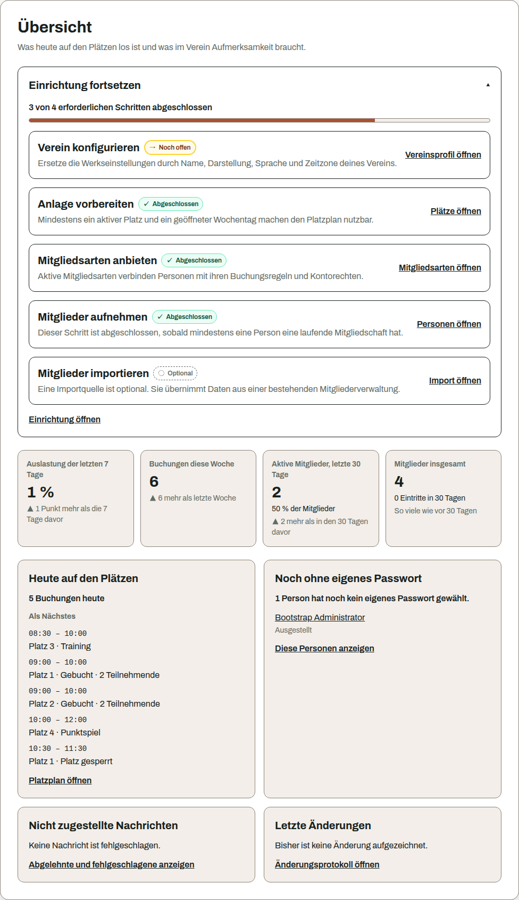

## Änderungen speichern

Jede Seite der Verwaltung speichert auf dieselbe Weise. Sobald du ein Feld änderst, erscheint am
unteren Rand eine Leiste. Sie nennt die Seite oder den Eintrag, dessen Änderungen noch nicht
gespeichert sind. *Speichern* übernimmt alle Änderungen der Seite auf einmal. *Änderungen
verwerfen* stellt den gespeicherten Stand wieder her.

Courtside speichert die Teile einer Seite in der Reihenfolge, in der sie dort stehen. Lehnt es
einen Teil ab, nennt die Meldung diesen Teil. Alles davor ist gespeichert, der abgelehnte Teil und
alles danach bleiben in der Leiste, bis du korrigierst und erneut speicherst.

Verlässt du eine Seite mit ungespeicherten Änderungen, fragt Courtside vorher nach. Das gilt auch
beim Neuladen oder Schließen des Tabs.

Eine eigene Schaltfläche haben nur Aktionen, die unabhängig vom Rest der Seite wirken, zum Beispiel
etwas neu anlegen, ein Logo hochladen oder entfernen, etwas deaktivieren oder Zugangsdaten senden.
Ihre Beschriftung sagt, was sie tut.


## Der geführte Weg: Einrichtung

Öffne *Verein → Einrichtung*. Die Checkliste prüft den aktuellen Stand und kennzeichnet jeden
Schritt als abgeschlossen, offen oder optional. Ein Haken steht für abgeschlossen, ein Pfeil für
offen und ein Kreis für optional.

Arbeite die Schritte in dieser Reihenfolge ab:

1. **Verein konfigurieren.** Hinterlege Name, Farben, Logo, Sprache und Zeitzone.
2. **Anlage vorbereiten.** Lege mindestens einen aktiven Platz und einen geöffneten Wochentag
   an.
3. **Mitgliedsarten anbieten.** Verbinde Mitgliedsarten mit Buchungsregeln und Kontorechten.
4. **Mitglieder aufnehmen.** Erfasse mindestens eine laufende Mitgliedschaft.
5. **Mitglieder importieren.** Dieser Schritt ist nur nötig, wenn eine andere
   Mitgliederverwaltung die führende Liste enthält.

Du kannst die Checkliste jederzeit verlassen. Beim nächsten Öffnen ermittelt Courtside den Stand
neu.

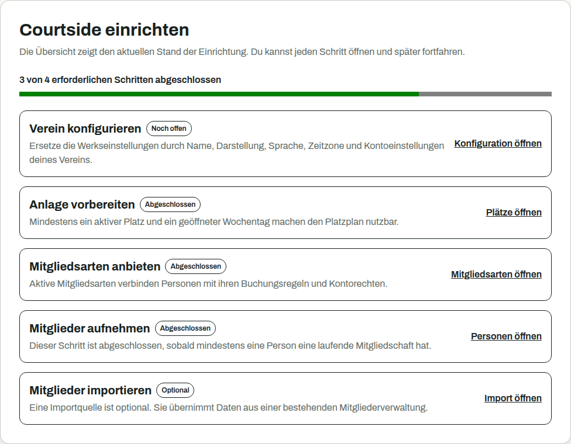

## Verein → Vereinsprofil

Öffne *Verein → Vereinsprofil* und bearbeite, wer der Verein ist und wie Courtside ihn zeigt.

### Verein und Darstellung

Trage Vereinsname, Primärfarbe, Akzentfarbe und Logo ein. Courtside zeigt für jede Farbe den
Kontrast zu hellem und dunklem Text. Für normalen Text gilt ein Verhältnis von mindestens 4,5 zu 1.

Logos müssen als PNG oder JPEG vorliegen. Die Datei darf höchstens 1 MiB groß sein und 2048 mal
2048 Pixel messen. Eine hochgeladene Datei ersetzt die Logo-URL, bis du die Datei entfernst.

Wer Courtside auf dem Smartphone zum Startbildschirm hinzufügt, bekommt ein App-Symbol aus dem
hochgeladenen Logo. Ein Logo, das nur als URL eingetragen ist, reicht dafür nicht: Dann zeigt das
Symbol die Courtside-Marke. Unter dem Symbol stehen etwa zwölf Zeichen. Trage dafür einen
**Kurznamen** ein, sonst kürzt Courtside den Vereinsnamen auf seine ersten Wörter. Die
Statusleiste der installierten App übernimmt die Primärfarbe beim nächsten Öffnen.

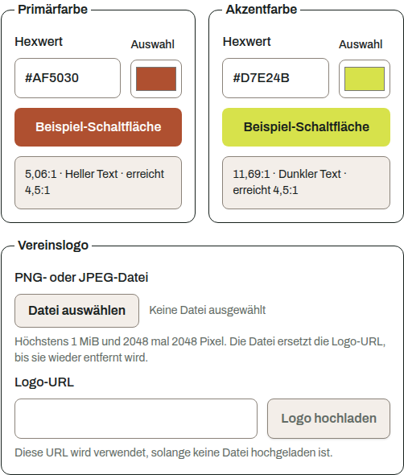

### Links, Sprache und Zeit

* Hinterlege unter **Impressum** und **Datenschutz** die Seiten des Vereins.
* Unter **Dokumentation** kannst du eine eigene Anleitung verlinken. Bleibt das Feld leer,
  führt der Link in der Fußzeile zur Courtside-Dokumentation. Der Link ist immer sichtbar, und
  die eingetragene Adresse ist wie Impressum und Datenschutz ohne Anmeldung abrufbar. Trage dort
  also nichts ein, das nicht jeder sehen soll.
* Die **Standardsprache** gilt für Personen ohne eigene Sprachauswahl.
* Gib eine gültige IANA-Zeitzone ein, zum Beispiel `Europe/Berlin`. Du kannst die Zeitzone
  nur ändern, solange keine zukünftige Buchung vorhanden ist.
* Das **Buchungsraster** bestimmt die Zeilen im Platzplan und die zulässigen Startzeiten.

## Verein → Fristen und Erinnerungen

Öffne *Verein → Fristen und Erinnerungen*.

* Der Wert 0 bei **Erinnerung vor einer Buchung** schaltet Erinnerungen aus. Ein anderer Wert legt
  den Abstand in Stunden fest.
* Stelle getrennt ein, wie lange Einmalpasswörter für neue und zurückgesetzte Konten gelten.
* Der Code zum Zurücksetzen darf zwischen 15 Minuten und einem Tag gültig sein. Nach Ablauf muss das
  Mitglied einen neuen Code anfordern.
* **Angebotsfrist der Warteliste** legt fest, wie viele Minuten ein frei gewordener Platz für das
  Mitglied reserviert bleibt, das auf der Warteliste an der Reihe ist. Vorgeschlagen sind 15 Minuten.
  Das Angebot endet spätestens mit dem Beginn der Zeit. Während es gilt, können andere Mitglieder und
  Trainer den Platz nicht buchen, und ihre Serien überspringen diesen Termin. Der Vorstand und eine
  Sperrung gehen vor: Bucht ein Admin den Platz, legt eine Serie darüber oder verschiebt eine dorthin,
  oder sperrt jemand den Platz, endet das Angebot. Das Mitglied sieht das unter *Meine Buchungen*.
* Unter **Anwesenheit** schaltest du die Erfassung ein. Mitglieder checken dann ab 15 Minuten vor
  Beginn bis zum Ende ihrer Buchung unter *Meine Buchungen* ein, und in einem begonnenen Termin unter
  *Termine* hältst du fest, ob die Spieler erschienen sind. Eine Buchung, für die nichts erfasst ist,
  zählt nie als Nichterscheinen. **Platz freigeben nach** storniert eine Mitgliederbuchung, für die 5
  bis 120 Minuten nach Beginn niemand eingecheckt hat, und gibt den Platz frei. Leer gelassen gibt
  Courtside keinen Platz frei. Bucher und Mitspieler bekommen bei einer Freigabe eine Nachricht. Eine
  Freigabe zählt nicht als Nichterscheinen.

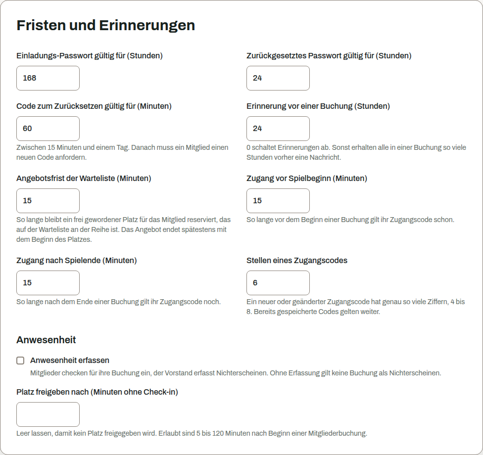

## Anlage → Plätze

Ein Platz braucht eine eindeutige Nummer und einen Namen. Beides änderst du direkt in der Liste
und speicherst alle geänderten Plätze gemeinsam.

Deaktiviere einen Platz, den der Verein nicht mehr nutzt. Der Platz verschwindet aus dem
Platzplan, bleibt aber in vergangenen Buchungen und Auswertungen erhalten. Courtside benachrichtigt
Mitglieder mit betroffenen zukünftigen Buchungen.

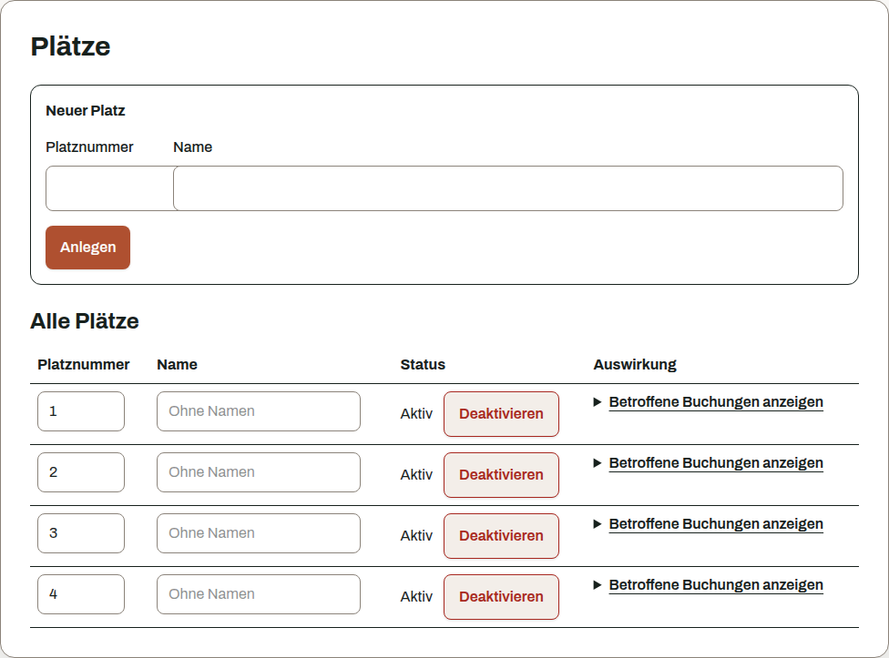

## Anlage → Zugänge

Ein Zugang ist eine Tür oder ein Tor auf dem Weg zu den Plätzen. Gib ihm einen Namen und wähle die
Plätze, zu denen er führt. Mehrere Plätze können sich einen Zugang teilen, und ein Platz kann über
mehrere Zugänge erreichbar sein. Hat der Zugang ein Tastenfeld, trage seinen Code ein. Er besteht nur
aus Ziffern und hat so viele Stellen, wie **Stellen eines Zugangscodes** auf derselben Seite festlegt.

Unter **Zugangszeiten und Codes** legen **Zugang vor Spielbeginn** und **Zugang nach Spielende**
fest, wie viele Minuten vor und nach einer Buchung ihr Zugangscode gilt, je 0 bis 240, vorgeschlagen
sind 15. **Stellen eines Zugangscodes** bestimmt, wie viele Ziffern ein neuer Code hat, 4 bis 8.
Codes, die schon gespeichert sind, gelten nach einer Änderung weiter.

Name, Plätze und Code änderst du jederzeit mit *Bearbeiten*. Ein leeres Codefeld entfernt den Code.
Einen Zugang, den es nicht mehr gibt, deaktivierst du. Im Protokoll steht, dass sich der Code
geändert hat, aber nie der Code selbst.

Erreicht ein Code eine Buchung neu, erhalten Bucher und Mitspieler mit eigenem Konto eine Nachricht
mit den Codes, die jetzt gelten. Das geschieht, wenn du einen Code änderst, einen Zugang mit Code
anlegst oder wieder aktivierst, einem Zugang mit Code einen Platz hinzufügst oder eine
Buchungskarte auf *Buchungen erhalten den Zugangscode* stellst. Einen Code oder Platz entfernen und
einen Zugang deaktivieren verschickt nichts.

**Für alle Mitglieder offen** zeigt den Code eines Zugangs allen aktuellen Mitgliedern oben in
*Meine Buchungen*, auch ohne Buchung, etwa für die Tür zum Clubhaus. Das Häkchen braucht einen Code,
und solange es gesetzt ist, lässt sich der Code nicht leeren. Änderst du den Code, setzt du das
Häkchen oder aktivierst du den Zugang wieder, bekommt jedes aktuelle Mitglied eine Nachricht mit dem
Code. Wer nicht mehr Mitglied ist, sieht den Code nicht mehr, kennt ihn aber, bis du ihn änderst.

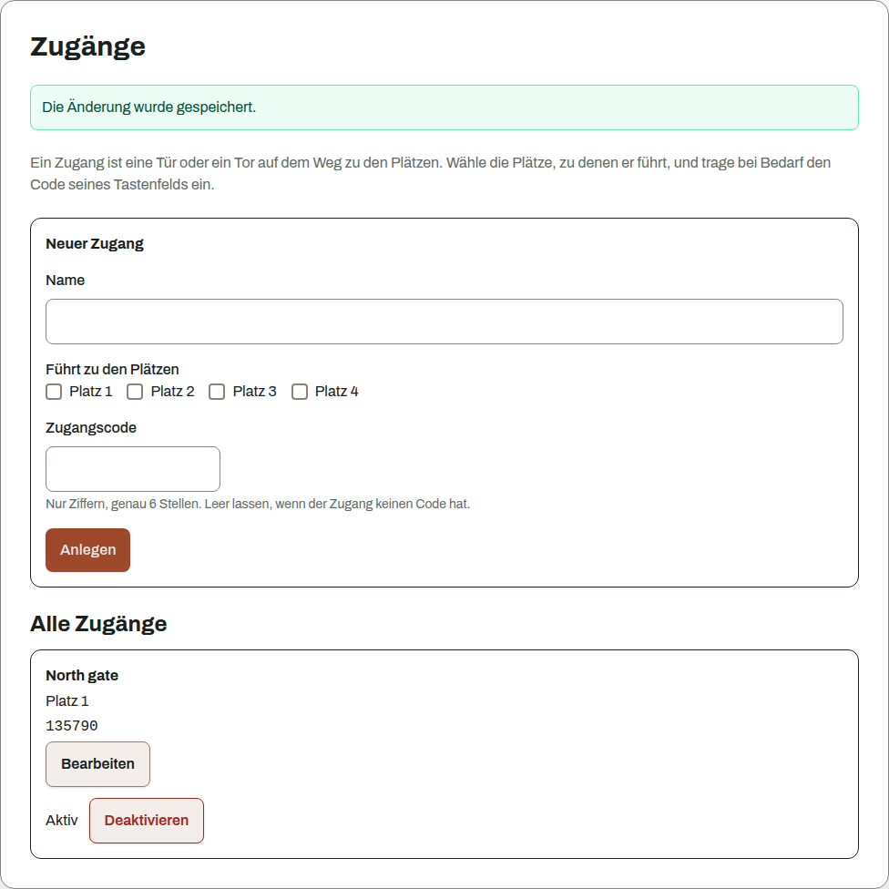

Ob die Bucher einer Buchung den Code erhalten, legt ihre Buchungskarte fest.

Ein Zugang ohne festen Code, dessen Codes ein angebundenes Zutrittssystem vergibt, kann einen
**Notfallcode** haben. Richte ihn am Tastenfeld dauerhaft ein. Er hat so viele Stellen wie ein
Zugangscode und darf keinem festen Code gleichen. Courtside verschickt ihn nie mit einer Buchung.
Bucher und Mitspieler fragen ihn in *Meine Buchungen* ab, wenn ihr eigener Code fehlt oder nicht
funktioniert, und nur, solange der Zugangscode ihrer Buchung gilt. Jede Abfrage steht im Protokoll
mit dem Konto, der Buchung und dem Zugang, nie mit dem Code. Wer ihn einmal abgefragt hat, kennt ihn,
bis du ihn änderst. Ändere ihn deshalb von Zeit zu Zeit und nach einem Missbrauch.

Ist ein Loxone Miniserver als Zutrittssystem angebunden, wählst du für jeden Zugang ohne festen Code
eine **Loxone-Gruppe**. Der Miniserver-Benutzer einer Buchung tritt dieser Gruppe bei, die Gruppe
entscheidet also, welche Tür sein Code öffnet. Die Auswahl zeigt die Gruppen, die Courtside bei der
letzten Prüfung des Miniservers gelesen hat. Ist sie leer, steht an ihrer Stelle ein Hinweis. Drücke
dann unter *Zugangsberechtigungen* auf **Jetzt prüfen**, nach der Prüfung erscheinen die Gruppen. Eine
gespeicherte Gruppe, die der Miniserver nicht mehr kennt, steht als *Unbekannte Gruppe* in der
Auswahl. Wähle dann eine andere oder entferne sie. Ein Zugang ohne Gruppe öffnet sich mit keinem
Buchungscode. Seine Berechtigungen scheitern mit dem Grund *access point has no Loxone group*, bis du
eine Gruppe wählst.

### Gebäudesteuerung

Flutlicht und Bewässerung bleiben in eurer Gebäudesteuerung. Sie fragt Courtside regelmäßig, ob ein
Platz belegt ist und wie viele Minuten bis zur nächsten Buchung bleiben. Courtside schaltet selbst
nichts. Unter **Gebäudesteuerung** am Ende dieser Seite legst du mit **Schlüssel anlegen** einen
Schlüssel an. Courtside zeigt ihn und die fertige Adresse genau einmal, kopiere beides sofort. Mit
**Neuen Schlüssel anlegen** ersetzt du ihn, mit **Schlüssel widerrufen** sperrst du jede Abfrage.
Beides wirkt bei der nächsten Abfrage. Ohne Schlüssel weist Courtside jede Abfrage ab. Trage nach
einem neuen Schlüssel die neue Adresse sofort in Loxone ein: Bis dahin behält Loxone den letzten Wert,
ein belegter Platz bleibt dort also belegt.

Die Adresse liefert zwei Zeilen je aktivem Platz, benannt nach seiner Platznummer:

```
court1.occupied=1
court1.minutes=0
court2.occupied=0
court2.minutes=37
```

`occupied` ist 1, solange eine Buchung läuft, deren Karte *Buchungen gelten für die Gebäudesteuerung
als belegt* trägt, sonst 0. `minutes` zählt die ganzen Minuten bis zum Beginn der nächsten solchen
Buchung, abgerundet. Während der Platz belegt ist, steht dort 0, und beginnt in den nächsten 24 Stunden
nichts, steht dort 1440. Eine Platzsperrung gilt nie als belegt. Ein deaktivierter Platz fehlt in der
Antwort, die Nummern der anderen bleiben. Änderst du die Nummer eines Platzes, gehören seine Werte
in Loxone zu einem anderen Befehl.

In Loxone Config legst du dafür an:

1. einen **Virtuellen HTTP Eingang** mit der Adresse aus Courtside als **URL**, zum Beispiel
   `https://courts.example.org/api/public/occupancy?key=…`, und **Abfragezyklus** 60 Sekunden;
2. darunter je Platz und Wert einen **Virtuellen HTTP Eingang Befehl**, etwa für Platz 1 mit der
   **Befehlserkennung** `\icourt1.occupied=\i\v` und einen zweiten mit `\icourt1.minutes=\i\v`.

Die Referenz-Installation nimmt Abfragen nur über HTTPS an, euer Miniserver muss dann HTTPS-Adressen
abfragen können. Betreibt ihr Courtside hinter eurem eigenen Proxy, entscheidet ihr selbst, ob ihr
diese Adresse auch über HTTP erreichbar macht. Der Schlüssel geht dann unverschlüsselt durchs Netz,
verrät aber nur die Belegung.

Ein Abfragezyklus von 60 Sekunden genügt. Kürzer bringt nichts, weil `minutes` sich nur einmal pro
Minute ändert. Fällt Courtside oder das Netz aus, behält Loxone den letzten Wert, bis die nächste
Abfrage wieder antwortet.

Was die Werte auslösen, entscheidet ihr in Loxone:

- **Flutlicht**: an, solange ein Platz belegt ist oder seine Minuten höchstens eure Vorlaufzeit
  betragen, etwa 10, und es dunkel genug ist, zum Beispiel über einen Helligkeitssensor oder die
  Dämmerung.
- **Bewässerung** je Platz oder Platzpaar: gesperrt, solange einer der Plätze belegt ist oder seine
  Minuten kleiner sind als Laufzeit plus Trockenzeit. Meldet der Loxone Wetterdienst Regen, fällt der
  Lauf aus.

Wer den Schlüssel kennt, erfährt nur Belegung und Minuten je Platz, nie wer gebucht hat oder mit
welcher Karte. Der Schlüssel steht in der Adresse und kann deshalb im Protokoll eines Routers oder
Proxys auftauchen. Ersetze ihn, wenn er in falsche Hände geraten ist.

## Anlage → Öffnungszeiten

1. Trage für jeden geöffneten Wochentag eine Öffnungs- und eine Schließzeit ein.
2. Markiere Tage ohne Spielbetrieb als geschlossen.
3. Nutze *Gleiche Zeiten übernehmen*, um ein Zeitfenster auf mehrere Tage anzuwenden.
4. Wähle unter *Gilt ab* den ersten Tag, für den die Woche gilt. Vorbelegt ist heute.
5. Speichere die Woche mit der Leiste am unteren Rand.

Liegt der Tag in der Zukunft, plant Courtside die Woche im Voraus, etwa Winterzeiten ab dem
1. November. Bis dahin gelten die bisherigen Zeiten. Vergangene Wochen behalten immer die Zeiten,
die an ihnen galten. Unter *Wochen* stehen die geltende Woche und alle geplanten. Eine geplante
Woche kannst du bearbeiten, auf einen anderen Tag verschieben oder entfernen. Die geltende Woche
entfernst du nicht, du ersetzt sie ab einem Tag durch eine neue.

Für eine vorübergehende Schließung ist *Geschlossen* das falsche Werkzeug. Dafür gibt es unter
*Saisons, Feiertage und Platzsperrungen* eigene Einträge, siehe den nächsten Abschnitt.

Courtside speichert keinen Tag, bei dem eine der beiden Zeiten fehlt. Außerhalb der Öffnungszeiten
sind keine Buchungen möglich. Wenn du Öffnungszeiten später verkürzt, benachrichtigt Courtside
die Mitglieder mit betroffenen Buchungen. Diese Buchungen bleiben bestehen und im Platzplan
sichtbar.

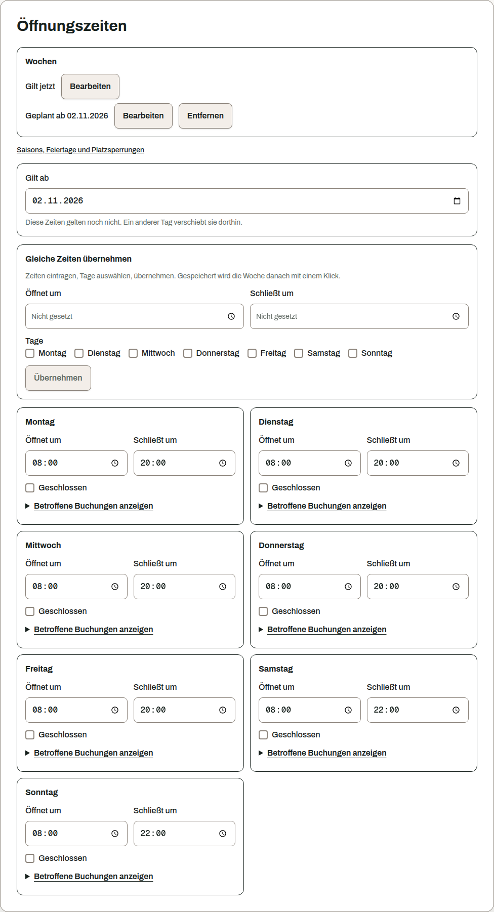

## Anlage → Öffnungszeiten → Saisons, Feiertage und Platzsperrungen

Der Link unter *Wochen* führt zu Einträgen, die für eine Zeitspanne gelten.

- Eine **Saison** ersetzt vom ersten bis zum letzten Tag die Wochenzeiten, mit eigenen Zeiten je
  Wochentag. Saisons überschneiden sich nicht.
- Ein **Feiertag** gilt vor Saison und Wochenzeiten. Er hat ein eigenes Zeitfenster oder ist
  ganz geschlossen. Ein neuer Feiertag übernimmt die Wochenzeiten seines ersten Tages, geschlossen
  ist er erst, wenn du *Geschlossen* ankreuzt. Ein Feiertag darf in einer Saison liegen, zwei
  Feiertage überschneiden sich nicht.
- Eine **Platzsperrung** nimmt einen Platz für ganze Tage aus dem Plan, etwa für eine Sanierung.
  Die anderen Plätze bleiben offen. Zwei Sperrungen desselben Platzes überschneiden sich nicht.

Ein Eintrag beginnt frühestens heute. Bis zu seinem ersten Tag kannst du alles ändern oder ihn
entfernen. Hat er begonnen, bleiben erster Tag und Zeiten fest, umbenennen oder früher beenden geht
weiterhin. Beendete Einträge bleiben unverändert, damit vergangene Tage ihre Zeiten behalten.

Buchungen, die schon auf einem gesperrten Tag liegen, bleiben bestehen. Neue Buchungen und
Verschiebungen dorthin lehnt Courtside ab. Im Platzplan steht ein Feiertag mit seinem Namen, ein
gesperrter Platz zeigt *Gesperrt*.

Trifft ein Eintrag bestehende Buchungen, nennt das Formular ihre Zahl, bevor du speicherst. Beim
Speichern bekommen Bucher und Mitspieler eine Nachricht in Courtside und per Mail. Sie erfahren den
Tag, den Platz und ob ein Feiertag, eine Saison oder eine Sperrung der Grund ist, nicht aber den
Namen, den du dem Eintrag gegeben hast. Wer schon benachrichtigt wurde, hört beim Verlängern
desselben Eintrags nichts zum zweiten Mal.

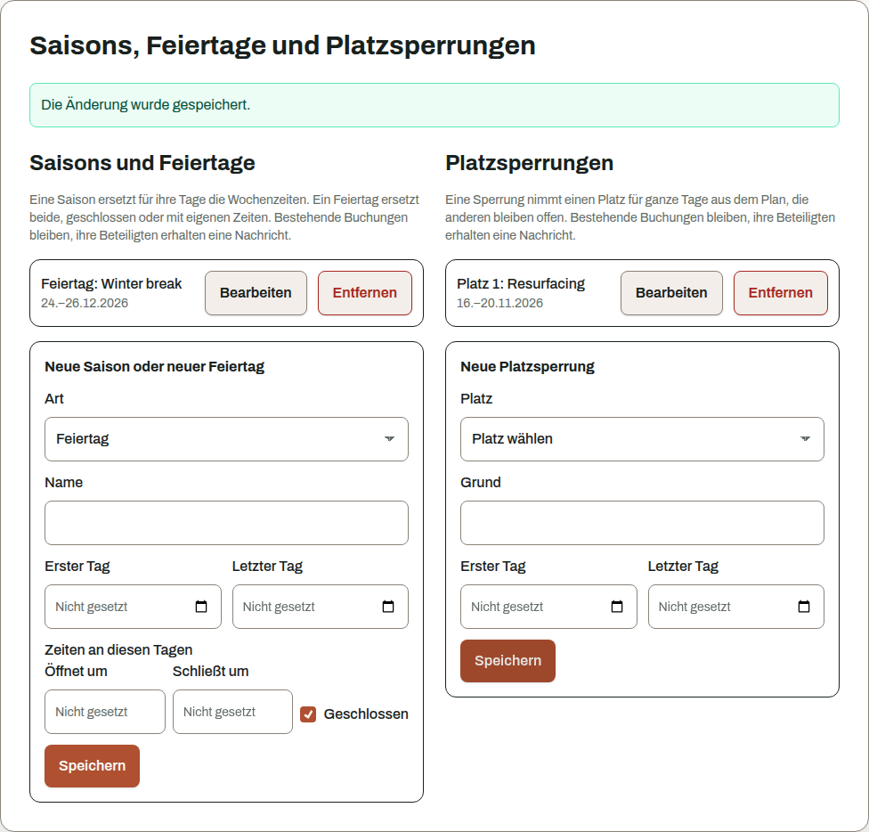

## Anlage → Buchungskarten

Buchungskarten unterscheiden die Arten einer Platzbelegung, etwa Mitgliederspiel, Training,
Punktspiel oder Sperrung. Lege für jede benötigte Art eine Karte an.

| Einstellung | Wirkung |
|---|---|
| **Bezeichnung und Farbe** | Darstellung im Platzplan. Courtside zeigt den Kontrast der Beschriftung zur Farbe und warnt unter 4,5 zu 1 |
| **Berechtigte Rollen** | Rollen, die mit der Karte buchen dürfen. Ohne Auswahl dürfen alle angemeldeten Personen buchen |
| **Verantwortliche Rollen** | Rollen, die jede Buchung dieser Karte öffnen, einsehen und stornieren dürfen |
| **Erlaubte Spielerzahlen** | Zulässige Zahl von Teilnehmenden. Ohne Wert erfasst die Karte keine Teilnehmenden |
| **Zählt gegen Buchungslimits** | Rechnet die Buchung auf die Obergrenze offener Buchungen an |
| **Gäste erlaubt** | Erlaubt namentlich erfasste Gäste |
| **Neutral anzeigen** | Zeigt im öffentlichen Platzplan *Belegt* statt der Kartenbezeichnung |
| **Buchungen erhalten den Zugangscode** | Buchungen mit dieser Karte gehören zu den Buchungen, für die der Code der Zugänge ihrer Plätze gilt. Die Karte *Platz gesperrt* bietet das nicht an |
| **Buchungen gelten für die Gebäudesteuerung als belegt** | Buchungen mit dieser Karte melden ihren Platz der Gebäudesteuerung als belegt, siehe *Gebäudesteuerung* unter *Zugänge*. Neue Karten tragen es, die Karte *Platz gesperrt* bietet es nicht an |

Administratoren dürfen jede Karte verwenden und verwalten. Eine Buchung mit der Karte *Platz
gesperrt* geht einer Reservierung von der Warteliste vor. Leerst du ihre berechtigten Rollen, darf
jede angemeldete Person sperren und damit jedes Angebot auf der Warteliste beenden.

Eine neutrale Anzeige schützt die
Bezeichnung nicht vor technischem Zugriff, da die öffentliche Schnittstelle sie weiterhin liefert.
Verwende deshalb keine vertraulichen Bezeichnungen.

Deaktiviere nicht mehr benötigte Karten. Bestehende Buchungen bleiben erhalten.

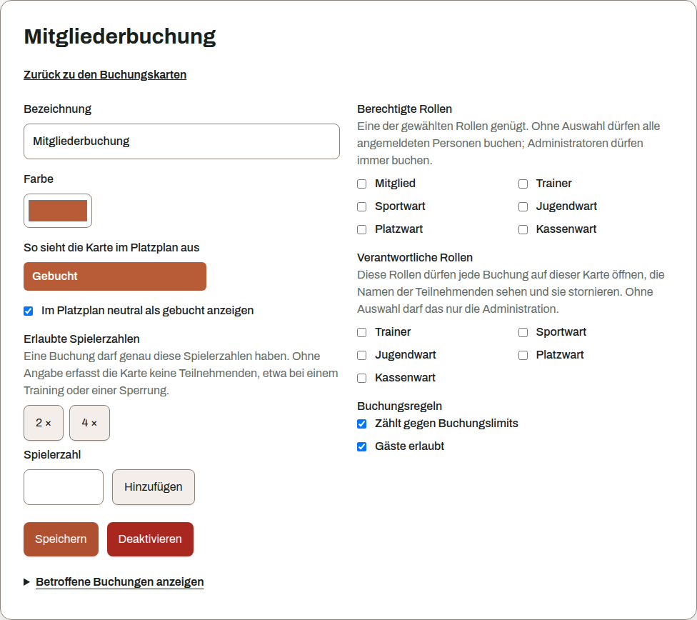

## Anlage → Platzfüller

Platzfüller belegen einen Spielerplatz, ohne eine Person zu sein. Beispiele sind eine Ballmaschine
oder der Eintrag "Spielpartner gesucht".

Gib eine Bezeichnung und optional die verfügbare Anzahl ein. Ein leeres Anzahlfeld erlaubt
beliebig viele gleichzeitige Verwendungen. Ist die begrenzte Anzahl belegt, lehnt Courtside weitere
Auswahlen für denselben Zeitraum ab.

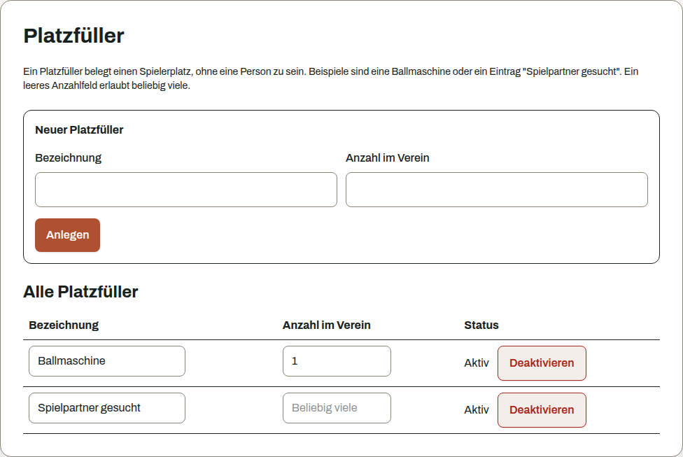

## Buchungsregeln

Öffne *Verein → Buchungsregeln*. Eine Mitgliedsart verweist auf ein Regelwerk. Die Übersicht
zeigt jedes Regelwerk mit seinem Status und den Mitgliedsarten, für die es gilt. Wähle dort ein
Regelwerk, um seine Regeln zu bearbeiten. Das Kästchen *In diesem Regelwerk* neben jeder Regel legt
fest, ob das Regelwerk sie enthält. Jedes Regelwerk kann diese Regeln höchstens einmal enthalten:

| Regel | Einstellung |
|---|---|
| Buchungsvorlauf | Höchste Zahl von Tagen im Voraus |
| Offene Buchungen | Höchste Zahl gleichzeitig offener Buchungen |
| Maximale Buchungsdauer | Höchste Dauer in Minuten |
| Stornierungsfrist | Mindestabstand zur Buchung in Minuten |
| Buchen gesperrt | Verbietet Mitgliedern das Buchen und Verschieben ohne weitere Einstellung |
| Buchungszeiten | Frühester Beginn und spätestes Ende einer Buchung an jedem Wochentag |
| Gebuchte Stunden pro Woche | Höchste Zahl von Stunden, die ein Mitglied von Montag bis Sonntag gebucht haben darf |
| Mindestdauer einer Buchung | Kürzeste Dauer in Minuten |
| Nichterscheinen | Ab dieser Zahl erfasster Nichterscheinen in den letzten Tagen nimmt Courtside keine Buchung des Mitglieds mehr an |

Öffnungszeiten und Buchungsraster gelten für den ganzen Verein. Sie stehen deshalb außerhalb der
Regelwerke. Buchungszeiten engen die Öffnungszeiten für eine Mitgliedsart ein, erweitern sie aber
nie. Hat die Anlage zum Beispiel bis 23:00 Uhr geöffnet, kann ein Jugendregelwerk Buchungen bis
20:00 Uhr erlauben. Wie die Öffnungszeiten enden Buchungszeiten spätestens um 23:59 Uhr. Gilt ein
Fenster bis Betriebsschluss, trage die Schließzeit der Anlage als spätestes Ende ein.
Die gebuchten Stunden pro Woche zählen die bestätigten Buchungen, die ein Mitglied selbst gebucht
hat, nach der Woche ihres Beginns. Stornierte Buchungen und Buchungsarten, die nicht gegen Limits
zählen, wie Training oder Sperrungen, bleiben außen vor. Administratoren können das Buchungsverbot,
die Buchungszeiten, die gebuchten Stunden pro Woche und die Mindestdauer für Verwaltungsaufgaben
übergehen. Das Zeit- und Platzraster gilt auch für sie.

Beim Stilllegen bleibt ein Regelwerk für bereits zugeordnete Mitgliedsarten wirksam. Es steht nur
nicht mehr für neue Zuordnungen bereit. Weise den betroffenen Mitgliedsarten zuerst ein anderes
Regelwerk zu, wenn sich ihre Regeln ändern sollen.

Wähle unter der Übersicht ein Regelwerk für Personen ohne aktuelle Mitgliedsart, wenn auch für
diese Gruppe mitgliedschaftsbezogene Regeln gelten sollen. Ohne Auswahl gelten weiterhin
Öffnungszeiten und Buchungsraster.

Name und Regeln des gewählten Regelwerks und das Regelwerk für Personen ohne Mitgliedsart speicherst
du gemeinsam. Wählst du ein anderes Regelwerk, bevor du gespeichert hast, fragt Courtside nach,
weil Name und Regeln zum gewählten Regelwerk gehören.

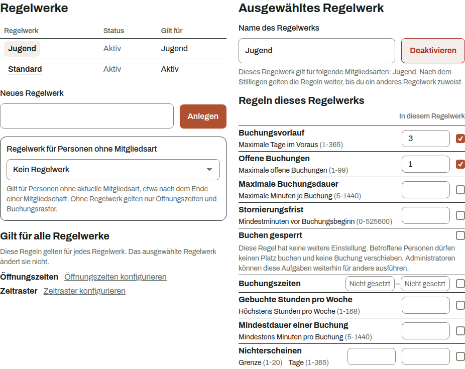

## Verein → Nachrichtentexte

Öffne *Verein → Nachrichtentexte*. Courtside liefert jede Nachricht auf Deutsch und Englisch aus.
Hier gibst du einer Nachricht den Betreff und Text deines Vereins.

* Wähle die **Nachricht** und die **Sprache**. Die Seite zeigt, ob der mitgelieferte oder dein
  eigener Text gilt.
* Die Liste darunter nennt die Platzhalter, die diese Nachricht füllt, etwa `{firstName}` oder
  `{instanceLink}` für die Adresse eures Courtside. Mit *(Pflicht)* markierte Platzhalter muss der
  Text enthalten: Benutzername und Einmalpasswort, Benutzername und Code. Ein Einmalpasswort oder
  Code darf nicht im Betreff stehen und muss im Text für sich stehen, durch Leerzeichen getrennt, damit
  er nie Teil eines Links wird. Der Betreff bleibt einzeilig.
* *Vorschau* füllt deinen Entwurf mit Beispielwerten und speichert nichts.
* *Text speichern* fragt bei Bedarf noch einmal nach deinem Passwort, weil der Text auch Nachrichten
  mit Zugangsdaten betrifft. Die nächste Nachricht dieser Art und Sprache verwendet ihn.
* *Mitgelieferten Text wiederherstellen* löscht deinen Text für diese Sprache.

Der Text ändert nur, was eine Nachricht sagt. Wer sie erhält, ob sie verschickt wird und ob ein
Mitglied sie abbestellen kann, bleibt gleich. Kann Courtside einen gespeicherten Text beim Versand
nicht füllen, geht der mitgelieferte Text hinaus. Jede Änderung steht im Änderungsprotokoll.

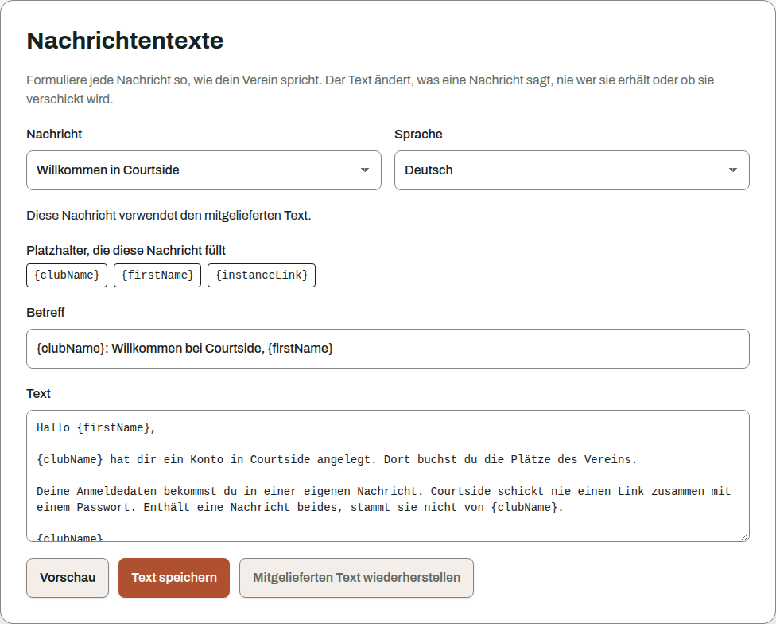

## Mitglieder → Mitgliedsarten

Eine Mitgliedsart hat eine Bezeichnung, ein Regelwerk und eine Einstellung für den Import. Die
Übersicht zeigt jede Art in einer Zeile, am Handy als eigene Karte, sodass du die Regelwerke
aller Arten untereinander vergleichst. *Regeln bearbeiten* öffnet genau das Regelwerk der Art.

Aktiviere **Zugang beim Import anlegen**, wenn importierte Mitglieder dieser Art automatisch
ein Konto erhalten sollen. Courtside sendet eine Willkommensnachricht und danach das Einmalpasswort
an die hinterlegte E-Mail-Adresse.
Bestehende Konten bleiben unverändert.

Beim Stilllegen bleiben bestehende Zuordnungen und deren Buchungsregeln erhalten. Die Mitgliedsart
kann danach nicht mehr neu vergeben werden.

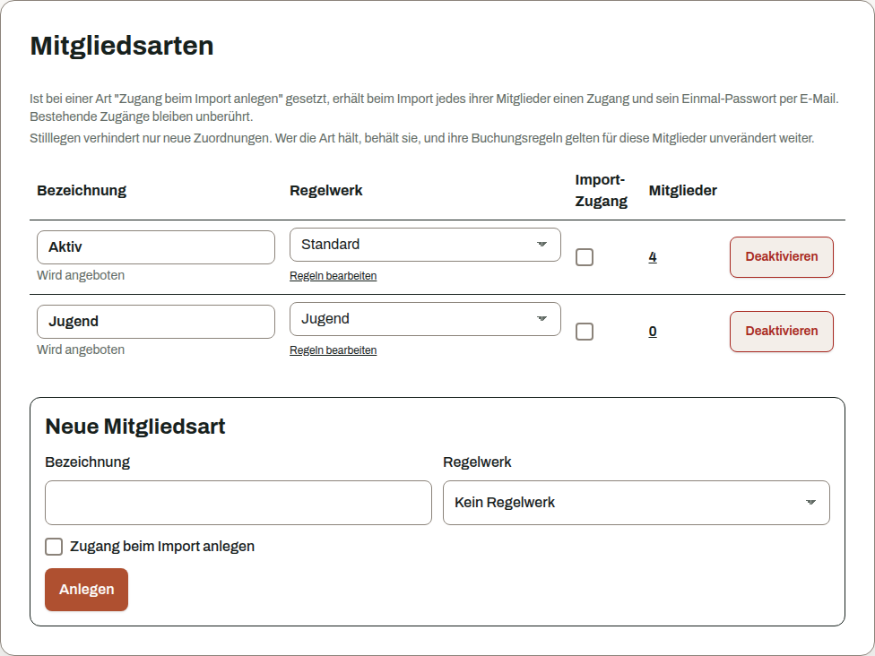

## Mitglieder → Personen und Konten

Oben legst du eine neue Person an. Darunter zeigt die Übersicht Name, Benutzername, Kontostatus,
Zugang, Mitgliedsart und Rollen, dazu die Zahl der Personen, auf die Suche und Filter passen. Ein
gesperrtes Konto ist farbig und mit eigenem Zeichen markiert. Die Spalte Zugang sagt, ob Zugangsdaten
noch nicht ausgestellt, ausgestellt oder abgelaufen sind oder ob das Mitglied ein eigenes Passwort
gewählt hat. Der Filter **Zugang** mit **Noch kein eigenes Passwort** listet alle, die noch kein
eigenes Passwort gewählt haben. Auf dem Smartphone sortierst du über **Sortieren nach** und **Reihenfolge**.
Vorname, Nachname und E-Mail-Adresse kannst du später korrigieren.

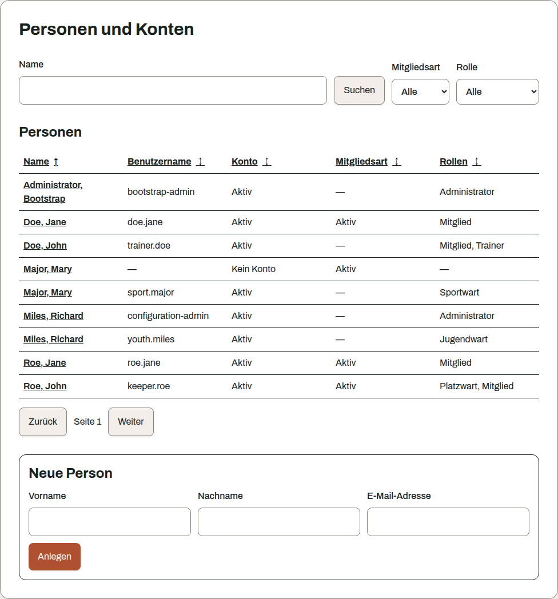

Nach dem Öffnen einer Person stehen diese Bereiche bereit:

* Unter **Person** bearbeitest du Vorname, Nachname und E-Mail-Adresse.
* Unter **Mitgliedschaft** bearbeitest du Mitgliedsart, Beginn und Ende. Beende eine
  Mitgliedschaft, statt sie zu löschen. Das Enddatum bleibt korrigierbar. Das Ende ist der erste
  Tag, an dem die Person nicht mehr Mitglied ist.
* Unter **Zeiträume der Mitgliedschaft** stehen alle Zeiträume dieser Person, auch ein Wechsel der
  Mitgliedsart oder ein Wiedereintritt. Ein Zeitraum darf in der Zukunft beginnen und gilt erst ab
  seinem ersten Tag. Zwei Zeiträume dürfen sich nicht überschneiden. Einen falsch erfassten
  Zeitraum korrigierst oder entfernst du dort.
* Unter **Konto** verwaltest du Benutzername, Sprache der Benachrichtigungen, Rollen, Status und
  Zugangsdaten. Für ein Konto ist eine E-Mail-Adresse erforderlich.

### Zugangsdaten senden

Vor dem Senden zeigt Courtside die Zieladresse und weist auf gemeinsam verwendete Adressen hin. Das
Einmalpasswort geht direkt an das Mitglied und wird dem Vorstand nicht angezeigt. Ein neues Konto
erhält vorher eine Willkommensnachricht, neue Zugangsdaten für ein bestehendes Konto nicht.

Neue Zugangsdaten ersetzen ein bereits gesetztes Passwort und beenden alle Sitzungen des Kontos.
Verwende diese Funktion nur, wenn das Mitglied sein Konto nicht selbst wiederherstellen kann.

Administratoren können die E-Mail-Adresse ändern und anschließend neue Zugangsdaten anfordern.
Courtside benachrichtigt danach die bisherige Adresse über die Änderung, ohne die neue zu nennen.
Wer eine vertippte Adresse korrigiert, schickt diesen Hinweis also auch an das vertippte Postfach. Das
Änderungsprotokoll hält beide Vorgänge mit Zeitpunkt und ausführendem Konto fest, aber weder die
Adresse noch das Passwort. Organisatorische Kontrolle, etwa mehrere verantwortliche Personen,
bleibt Aufgabe des Vereins.

### Nichterscheinen aufheben

Bei einer Person mit Konto zeigt der Abschnitt **Nichterscheinen**, welche erfassten Nichterscheinen
noch zählen. **Nichterscheinen aufheben** lässt sie erfasst, aber nicht mehr zählen. Damit endet die
Sperre der Regel *Nichterscheinen*. Ein später erfasstes Nichterscheinen zählt wieder.

### Konto deaktivieren

Deaktiviere das Konto, wenn eine Person keinen Zugriff mehr erhalten soll. Courtside beendet
alle Sitzungen. Buchungen und Auswertungen bleiben erhalten. Das Konto kann später wieder aktiviert
werden.

### Daten einer Person ausgeben

*Auskunft über gespeicherte Daten* erstellt eine Datei mit den Daten dieser Person. Sie enthält
Personen- und Kontodaten, Mitgliedschaft, Buchungen mit dem Zeitpunkt, zu dem ein offener Platz
angeboten wurde, Serien, eigene Wartelisteneinträge und Wartelisten, in denen die Person eingetragen
ist, Nachrichten, Einträge der Benachrichtigungen mit der jeweils betroffenen Buchung oder dem
Wartelisteneintrag, Abwahlen, Importreferenzen und zugehörige Einträge im Änderungsprotokoll. Prüfe die Datei vor der
Weitergabe. Die Erstellung selbst erscheint danach im Änderungsprotokoll.

Die gesamte Personenliste kannst du als CSV exportieren. Optional enthält sie die
Mitgliedsnummern einer Importquelle.

## Mitglieder → Import

Nutze den Import, wenn eine andere Mitgliederverwaltung die führende Liste des Vereins
enthält. Der Ablauf besteht aus Quelle, Vorschau und Ausführung.

### Beispiel für einen Probelauf

Die [vollständige Beispieldatei](/examples/roster-import-example.csv) enthält 24 erfundene
Personen: 18 Erwachsene und 6 Jugendliche. Die
[geänderte Beispieldatei](/examples/roster-import-example-update.csv) enthält 23 dieser Personen.
Sie ändert die E-Mail-Adresse von `EX-1001`, ordnet `EX-1002` der Kategorie `Junior` zu und lässt
`EX-2006` weg. Alle Adressen verwenden die reservierte Domain `example.org`.

Bereite für einen reproduzierbaren Probelauf eine frische Testinstanz so vor:

1. Lege aktive Mitgliedsarten namens `Adult` und `Junior` an. Aktiviere bei beiden
   *Zugang beim Import anlegen*, wenn der Probelauf auch die Kontoerstellung prüfen soll.
2. Lege eine Importquelle namens `Acceptance example` mit UTF-8 und dem Trennzeichen Semikolon an.
3. Ordne die Spalten wie folgt zu:

| CSV-Spalte | Courtside-Feld |
|---|---|
| `Member number` | Mitgliedsnummer |
| `First name` | Vorname |
| `Last name` | Nachname |
| `Email` | E-Mail-Adresse |
| `Category` | Kategorie |

4. Ordne den Wert `Adult` der gleichnamigen Mitgliedsart und `Junior` der gleichnamigen
   Mitgliedsart zu. Markiere Vorname, Nachname, E-Mail-Adresse und Kategorie als von der Quelle
   geführte Felder.

Spiele die Dateien in dieser Reihenfolge durch:

| Schritt | Datei und Modus | Erwartetes Ergebnis |
|---|---|---|
| Erstimport | vollständige Datei, vollständige Liste | Die Vorschau zeigt 24 neue Personen, davon 18 `Adult` und 6 `Junior`. Bei aktivierter Kontoerstellung plant sie 24 Konten. Nach der Ausführung enthält eine Personenliste, die vorher nur das Administratorkonto enthielt, zusätzlich 24 Personen. |
| Wiederholung | vollständige Datei, vollständige Liste | Die Vorschau enthält keine Personenänderung, keine neue Mitgliedschaft und kein neues Konto. |
| Teilliste | geänderte Datei, Teilliste | Die Vorschau ändert zwei Personen. `EX-2006` bleibt mit laufender Mitgliedschaft erhalten, weil eine Teilliste fehlende Zeilen ignoriert. |
| Ausgangsdaten wiederherstellen | vollständige Datei, Teilliste | Die beiden geänderten Werte werden zurückgesetzt. Alle 24 importierten Mitgliedschaften laufen wieder im Ausgangszustand. |
| Vollständige Liste | geänderte Datei, vollständige Liste | Die Vorschau ändert zwei Personen und warnt vor einer endenden Mitgliedschaft. Nach der Ausführung bleiben 24 Personen gespeichert, davon haben 23 eine laufende Mitgliedschaft. Das reine Mitgliedskonto von `EX-2006` wird deaktiviert. |

Führe den letzten Schritt nur in einer Testinstanz aus. Ein späterer Import aktiviert ein dadurch
deaktiviertes Konto oder eine entfernte Mitgliedsrolle nicht automatisch wieder.

### 1. Quelle beschreiben

Hinterlege Bezeichnung, Trennzeichen, Zeichensatz und Spaltenzuordnung. Ordne externe
Kategorien den Mitgliedsarten in Courtside zu.

Markiere außerdem die Felder, die die Quelle künftig führen soll. Bei bestehenden Personen
überschreibt jeder Import diese Felder. Nicht markierte Felder bleiben unverändert. Neue Personen
erhalten beim ersten Import trotzdem alle zugeordneten Werte aus der Datei.

Prüfe diese Entscheidung besonders für die E-Mail-Adresse. An diese Adresse gehen
Einmalpasswörter und Codes zur Kontowiederherstellung.

Die Beispieldatei für die Spaltenzuordnung bleibt im Browser und wird nicht hochgeladen.

Hat dein Export keine Kopfzeile, wähle *Nach Position*. Courtside zeigt dann die ersten Zeilen der
Beispieldatei in nummerierten Spalten, und du ordnest jedem Feld eine Spaltennummer zu. Die
Spaltenzahl übernimmt das Formular aus der Beispieldatei. Kann der Browser den Zeichensatz nicht
anzeigen, trägst du sie selbst ein. Sieht die erste Zeile wie eine Kopfzeile aus, weist das
Formular darauf hin, denn nach Position gelesen würde sie als Mitglied importiert.

Eine Datei mit anderer Spaltenzahl lehnt Courtside ab, bevor eine Zeile gelesen wird. So landet
kein Wert in einem falschen Feld, wenn das Vereinsprogramm eine Spalte ergänzt oder entfernt.
Wechselst du die Lesart einer gespeicherten Quelle, fragt das Formular vor dem Speichern nach.
Die nächste Datei wird dann auf die neue Art gelesen.

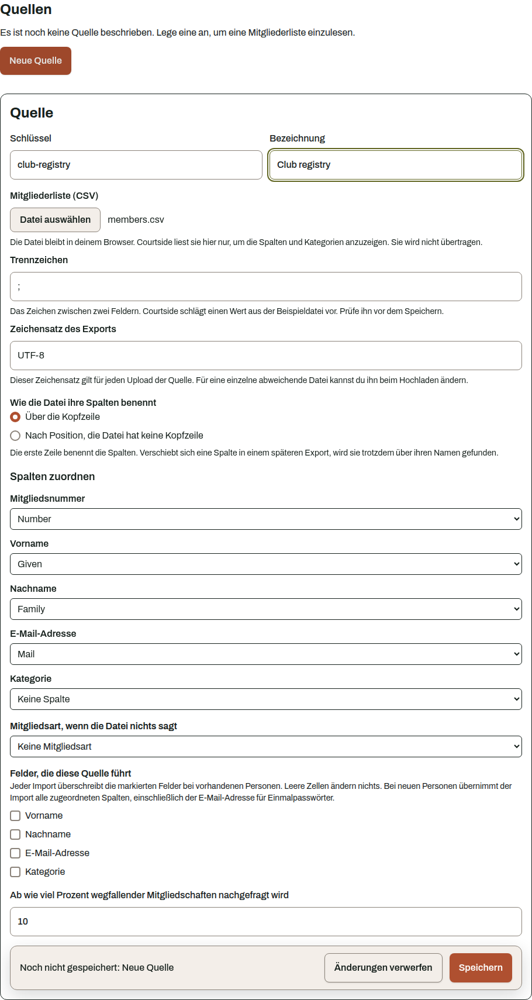

### 2. Datei prüfen

Der Upload erzeugt zuerst eine Vorschau. Noch ändert sich keine Person. Die Vorschau zeigt
Dateiname, Zeilenzahl, Prüfsumme, Änderungen, übersprungene Zeilen, mögliche Dubletten, gemeinsam
verwendete E-Mail-Adressen und geplante Konten.

Lehnt Courtside die Datei ab, steht der Grund direkt unter dem Knopf. Eine Vorschau der vorigen
Datei verschwindet dann, damit niemand sie für das Ergebnis der neuen hält.

Die Datei selbst wird nicht gespeichert. Die ermittelte Änderungsmenge mit Namen, Adressen und
Mitgliedsnummern bleibt bis zum Ende ihrer Aufbewahrungsfrist in der Instanz.

Wähle den passenden Modus:

* Eine **Teilliste** ändert nur enthaltene Personen.
* Eine **vollständige Liste** beendet Mitgliedschaften, deren Zeilen fehlen. Reine Mitgliedskonten
  werden deaktiviert. Konten mit zusätzlichen Rollen bleiben aktiv, verlieren aber die
  Mitgliedsrolle. In beiden Fällen enden die Sitzungen.

Ein Import erkennt Personen nur an Mitgliedsnummer und Quelle. Verknüpfe bereits erfasste
Personen vor der Ausführung, sonst entstehen Dubletten. Prüfe gleichnamige Personen und
gemeinsam verwendete E-Mail-Adressen von Hand.

### 3. Import ausführen

Prüfe die Zusammenfassung und wähle *Import ausführen*. Überschreitet der Anteil
endender Mitgliedschaften die eingestellte Schwelle, verlangt Courtside eine zusätzliche
Bestätigung. Die gesamte Änderungsmenge wird in einer Datenbanktransaktion gespeichert.

Ein späterer korrekter Import stellt deaktivierte Konten oder entfernte Mitgliedsrollen nicht
automatisch wieder her. Nach einer versehentlich unvollständigen Liste musst du betroffene Konten
aktivieren und Mitgliedsrollen neu vergeben.

## Nachweise

Unter **Nachweise** findest du neun Ansichten. Die *Aufbewahrung* beschreibt der nächste Abschnitt.

* **Statistik** zeigt beim Öffnen den letzten vollen Monat. Oben wählst du einen anderen Zeitraum:
  7 Tage, 1, 3, 6 oder 12 Monate bis heute, alles seit der ersten Buchung, das letzte Kalenderjahr
  oder zwei Daten deiner Wahl. Der Zeitraum steht in der Adresse der Seite, ein Lesezeichen öffnet
  also dieselbe Auswertung. Jede Kennzahl nennt ihre Veränderung gegenüber dem gleich langen
  Zeitraum davor. Alle Zahlen sind Summen und nennen niemanden.
  * Die Auslastung zeigt Belegung, gebuchte und gesperrte Zeit, den Verlauf je Woche oder Monat,
    eine Tabelle nach Wochentag und Uhrzeit und die Werte je Platz und je Buchungskarte. Belegung
    ist gebuchte Zeit geteilt durch die Öffnungszeit ohne Sperrungen. Jeder Tag rechnet mit den
    Öffnungszeiten, die an ihm galten. Spielzeit außerhalb der Öffnungszeiten zählt nicht.
  * Das Buchungsverhalten zeigt bestätigte und stornierte Buchungen, die Stornoquote, Serien und
    Einzelbuchungen, Gäste und genutzte Platzfüller.
  * Bei den Mitgliedern stehen Bestand am Ende des Zeitraums, Eintritte, Austritte, aktive Mitglieder,
    Mitgliedsarten und Konten. Aktiv ist, wer am Ende des Zeitraums Mitglied ist und im Zeitraum
    eine bestätigte Buchung angelegt hat oder darin eingetragen war. Für Zeiträume, deren Buchungen
    schon pseudonymisiert sind, fehlt diese Zahl.
  * Die Nachrichten zählen je Art, wie viele in Arbeit, übergeben, abgelehnt oder fehlgeschlagen sind.
* **Nutzung** beantwortet vier Fragen für einen Zeitraum, ohne Angabe den letzten vollen Monat,
  oder für zwei Daten deiner Wahl. Gezählt werden die Buchungen, die im Zeitraum beginnen, und
  niemand wird genannt.
  * Die Kapazität zeigt, welche Buchungskarte und Mitgliedsart wie viel der offenen Platzzeit belegt
    hat.
  * Die Stornierungen teilen sich auf in die durch das Mitglied, die durch den Verein und die ohne
    Check-in freigegebenen Buchungen. Die Stornierungen des Vereins stehen nach seinem Grund.
  * Die Anwesenheit zählt erschienene Buchungen, zählende und aufgehobene No-Shows. Eine Buchung
    ohne Erfassung zählt nirgends mit.
  * Von den Regeln abgelehnt zählt die Buchungs-, Serien- und Stornoversuche, die die Regeln
    abgelehnt haben, je Regel.

  Eine Karte oder Mitgliedsart, hinter der weniger als drei Mitglieder stehen, erscheint nie in
  einer eigenen Zeile. Sie geht in *Sonstige* auf, die Summen bleiben vollständig, und aus einer
  kleinen Gruppe lässt sich niemand ablesen.
* **Datenexport** erstellt CSV-Dateien für Buchungen, Mitglieder, das Änderungsprotokoll und das
  Nachrichtenprotokoll. Trennzeichen und Zeichensatz wählst du bei jedem Download, die Einstellungen
  der Importquelle bleiben dabei unverändert. Der Buchungsexport enthält keine buchende Person. Der
  Mitgliederexport enthält personenbezogene Daten und erzeugt keinen Eintrag im Änderungsprotokoll.
  Die beiden Protokollexporte enthalten ohne Zeitraum alle Einträge bis zum Moment des Downloads,
  mit Namen wie in den Protokollansichten. Jeder Protokollexport erscheint im Änderungsprotokoll mit
  "Ganze Instanz" als Gegenstand. Beginnt ein Wert mit `=`, `+`, `-` oder `@`, steht ein Apostroph
  davor, damit die Tabellenkalkulation ihn als Text liest und keine Formel ausführt.
* **Änderungsprotokoll** zeigt administrative Änderungen mit Zeitpunkt, Gegenstand und
  ausführendem Konto. Eine Buchung erscheint mit ihren Plätzen und ihrem aktuellen Termin, eine
  Serie mit ihren Plätzen und ihrem aktuellen ersten Termin, auch bei einem Eintrag von vor einer
  späteren Verschiebung. Suche nach dem Namen eines Gegenstands, eines Platzes oder einem
  Benutzernamen und grenze die Treffer bei Bedarf nach der Art der Änderung und dem Zeitraum ein.
  *Weitere laden* behält die aktiven Filter bei; *Filter zurücksetzen* zeigt wieder das
  vollständige Protokoll.
* **Nachrichtenprotokoll** zeigt den Versandstatus. *Übergeben* bedeutet nur, dass der Mailserver
  die Nachricht angenommen hat. Die endgültige Zustellung steht allein in dessen Protokoll.
* **Betriebsprotokoll** zeigt jüngste, vor der Speicherung bereinigte Meldungen aus Anwendung,
  Datenbank und Reverse-Proxy. Filtere nach gemeldeter Quelle, Schweregrad, Vereinszeit, Meldung oder Trace-ID.
  Hinweise über fehlende, entfernte oder unvollständige Daten gehören zum Ergebnis. Die Ansicht ist
  kein dauerhaftes Logarchiv und zeigt keine beliebigen Container des Servers. Die Quelle ist nicht
  authentifiziert: Ein lokaler Prozess auf dem Server kann einen der festen Quellnamen nachahmen.
* **Betriebsübersicht** zeigt, was die Instanz über sich selbst nachweisen kann: Version,
  Datenbankschema, Mailversand, öffentliche Adresse und letzte Sicherung. Jeder Punkt ist
  *In Ordnung*, *Gestört* mit dem Ort der Störung oder *Nicht belegt*. Nicht belegt heißt nicht in
  Ordnung. Courtside hat für diesen Punkt keinen Nachweis. Die letzte Sicherung bleibt nicht belegt,
  bis der Betrieb ihren Zeitpunkt einträgt. Die Ansicht prüft beim Öffnen und wenn du **Neu
  prüfen** drückst. Sie meldet nichts von selbst. Eine Warnung bei einer zu alten Sicherung
  richtet der Betrieb in seinem eigenen Monitoring ein.

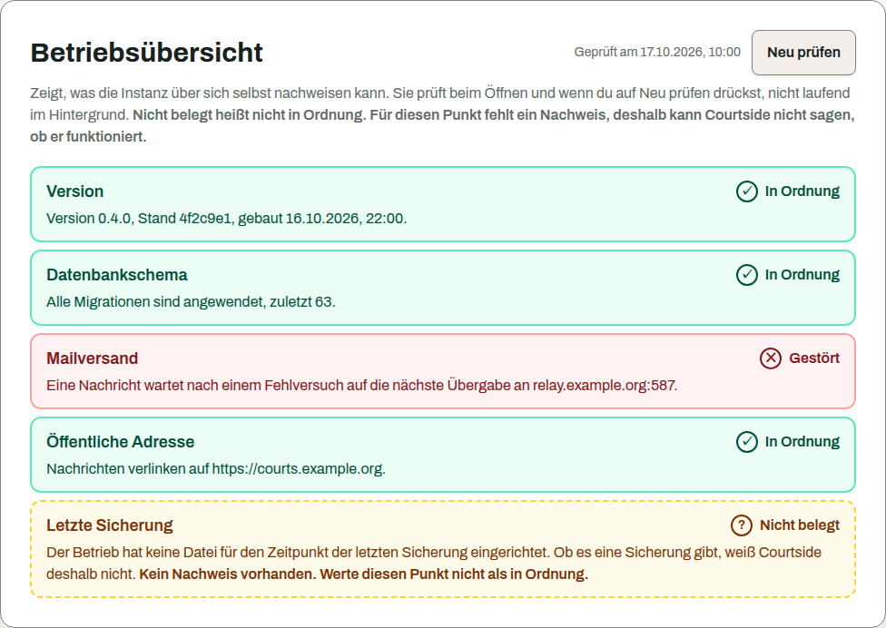

* **Zugangsberechtigungen** zeigt, welche Codes ein angebundenes Zutrittssystem pro Buchung hält.
  Jede Buchung, deren Karte Zugang gewährt, erhält dort einen eigenen Code für die Zugänge ihrer
  Plätze. Ein Zugang mit festem Code bekommt keine Einzelcodes je Buchung: Für ihn gilt weiter nur
  sein fester Code. Courtside richtet den Code ein, sobald die Buchung so nah ist, wie Mitglieder im
  Voraus buchen dürfen. Weiter entfernte Termine einer Serie folgen später. Eine Berechtigung
  *Wartet*, ist *Eingerichtet*, *Wird entfernt* oder ist *Gescheitert*. Gescheiterte stehen oben, mit
  der letzten Antwort des Zutrittssystems. Courtside versucht es nach einer, fünf, fünfzehn und
  sechzig Minuten erneut. Nach dem fünften Fehlschlag oder einer Ablehnung gilt die Berechtigung als
  gescheitert. Behebe dann die Ursache im Zutrittssystem und drücke **Erneut senden**. Ein Entfernen
  versucht Courtside ohne Ende weiter. Über der Liste steht, was das Zutrittssystem bei der letzten
  Prüfung geantwortet hat. **Jetzt prüfen** lässt Courtside beim nächsten Durchgang neu nachfragen.
  Den Code selbst zeigt die Ansicht nie. Ohne angebundenes Zutrittssystem bleibt die Liste leer und
  die Buchungen laufen wie bisher.

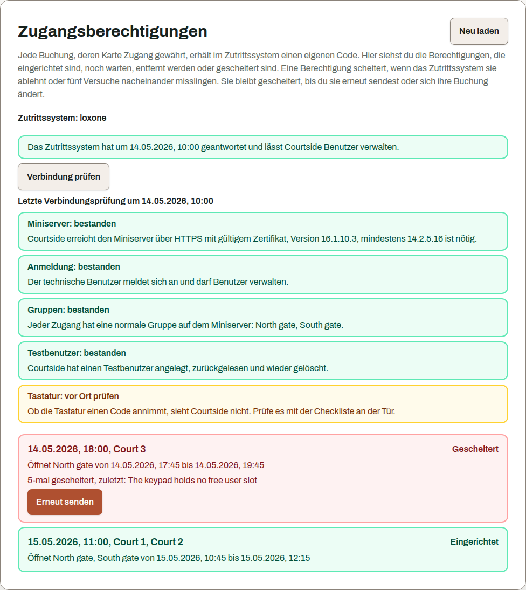

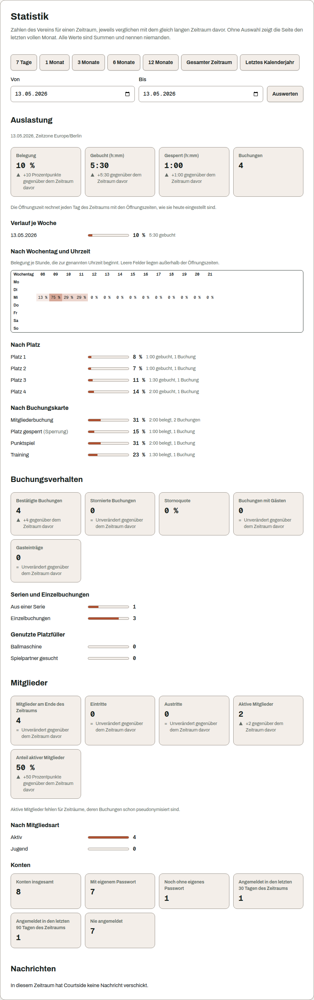

## Nachweise → Aufbewahrung

Hier legt der Verein fest, wie lange er personenbezogene Daten nach ihrem Ende aufbewahrt. Courtside
gibt keine Frist vor. Eine Kategorie ohne Frist bleibt unberührt, ganz gleich, wie alt ihre Daten
sind. Welche Frist rechtmäßig ist, entscheidet der Verein als Verantwortlicher. Das
[Datenschutz-Kit](privacy-kit.md) hilft beim Dokumentieren dieser Entscheidung, ersetzt aber keine
Rechtsberatung.

Es gibt zwei Kategorien, jede mit einer Frist in Monaten von 1 bis 1200:

* **Buchungen** pseudonymisiert Buchungen und Serien, die vor der Frist endeten. Bucher, stornierende
  und verschiebende Konten, Notizen, mitspielende Mitglieder und die Namen von Gästen verschwinden.
  Karte, Plätze, Zeiten, Status und die Zahl der Gastplätze bleiben, deshalb rechnen Auslastung,
  Nutzung und Buchungszahlen weiter mit diesen Buchungen.
* **Ehemalige Mitglieder** entfernt eine Person, deren Mitgliedschaft vor der Frist endete und deren
  Konten sich seither nicht angemeldet haben und nicht neu angelegt wurden. Mit ihr verschwinden
  ihre Konten und alles, was an ihnen hängt.

Lies vor dem Setzen einer Buchungsfrist, was dir danach fehlt: Für pseudonymisierte Zeiträume zählt
die Statistik keine aktiven Mitglieder mehr, und die Nutzung kann die Kapazität dieser Zeit keiner
Mitgliedsart mehr zuordnen. Eine Austrittsmeldung erledigt nicht die
Aufbewahrung: Wer geht, wird mit *Mitgliedschaft beenden* ausgetragen, und erst die Frist entfernt
die Person später.

Ein Lauf beginnt immer mit *Vorschau erstellen*. Die Vorschau ändert nichts. Sie zählt, wie viele
Buchungen, Serien, ehemalige Mitglieder und Konten ein Lauf jetzt erfassen würde, und nennt die
Personen, die er noch nicht erreicht, mit dem Grund:

* Ein Konto der Person hat die Rolle *Administrator*.
* Eine Buchung oder Serie, die bleibt, nennt die Person noch.
* Die Person wartet auf einen Platz.

Über *Person öffnen* erreichst du die Person und kannst den Grund beheben. Erst wenn du im Formular
bestätigst, dass der Lauf nicht rückgängig zu machen ist, startet *Endgültig ausführen* genau diese
Vorschau. Fehlt eine frische Passwortbestätigung, fragt Courtside dein Passwort ab. Eine Vorschau
gilt 30 Minuten, nur das Konto, das sie erstellt hat, kann sie ausführen, und sie läuft höchstens
einmal. Wer sich seit der Vorschau wieder angemeldet hat, wird übersprungen und gezählt. Das
Änderungsprotokoll hält die gesetzten Fristen und die Zahlen eines Laufs fest, nie die Namen.

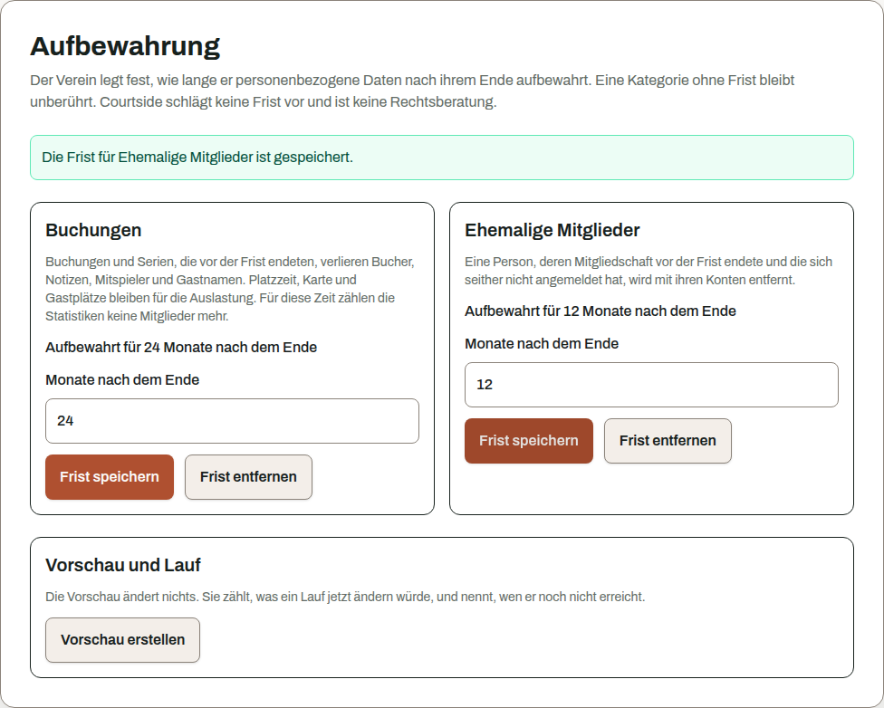

## Zwei Regeln, die überall gelten

Courtside bewahrt fachliche Historie auf. Deaktiviere Plätze, Buchungskarten und Konten oder lege
Regelwerke und Mitgliedsarten still. Beende Mitgliedschaften. Lösche diese Daten
nicht, wenn die Vergangenheit weiterhin nachvollziehbar bleiben soll. Personenbezogene Daten nach
Ablauf einer Frist entfernt allein die *Aufbewahrung*.

Eingabefehler bleiben korrigierbar. Ändere Namen, Benutzernamen und Datumsangaben in der
jeweiligen Verwaltung. Dafür ist kein direkter Datenbankzugriff nötig.

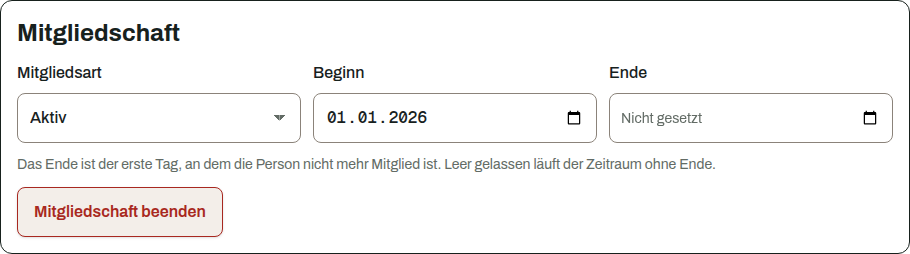
