# Board handbook

This handbook covers initial setup and routine administration of a Courtside instance. Button and
menu names appear in *italics*. Each club chooses its own opening hours, deadlines and limits.

## Who sees the administration

Enabled accounts with the **Administrator** role can open the complete administration. Other
accounts only see *Club appointments*, and only when an active booking card names one of their
roles other than *Member* as a managing role or lets one of their roles book it without a player
list. The list shows
what the managing roles cover, the series form what the booking roles allow. An account no card
grants either cannot enter, not even by typing the address directly. Board members change this on
the booking cards.

The sidebar leads to the overview at the top and divides administration below it into four areas:

| Area | Contents |
|---|---|
| **Club** | Setup, club profile, deadlines and reminders, booking rules, message wording |
| **Facility** | Courts, opening hours, booking cards and slot fillers |
| **People** | People, accounts, membership types and imports |
| **Records** | Statistics, usage, data exports, retention, change log and message log |

The same sidebar returns you to the court plan.

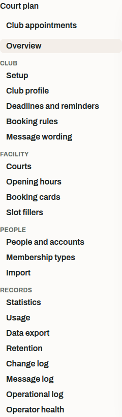

### Club appointments

*Club appointments* initially shows at most 20 upcoming appointments, nearest first. Switch to
*History* for past and cancelled appointments. You can filter by court or booking type and load
further matches page by page. Loaded occurrences of one series start grouped and collapsed.
*Details* remains directly available; *Cancel* sits under *Actions*. Create a new series at the top
of the page.

When you cancel somebody else's appointment, you may choose a reason: court condition, weather, club
event, maintenance work or another reason. The member who booked and the players are told it. There
is no free text. When you cancel or move dates of somebody else's series, its holder receives one
message covering every affected date.

## The overview

Administration opens on the *Overview*. It shows today's bookings and the ones still to come, the
people without a password of their own, refused or failed messages and the latest changes. Each
part leads to the page where you continue, already filtered.

Above them, four key figures show utilisation of the last 7 days, bookings this week, active
members of the last 30 days with their share of all members, and members in total with the joins of
the last 30 days. Each says how it changed against the period of equal length before it. This week
runs from Monday to Sunday and already counts bookings made for the days still ahead, so early in
the week it trails the whole week before. Selecting a figure opens the statistics for its period.

While a required setup step is still open, setup sits unfolded at the top. Once all of them are
done, the overview sums setup up in one line. Selecting it unfolds the steps again.

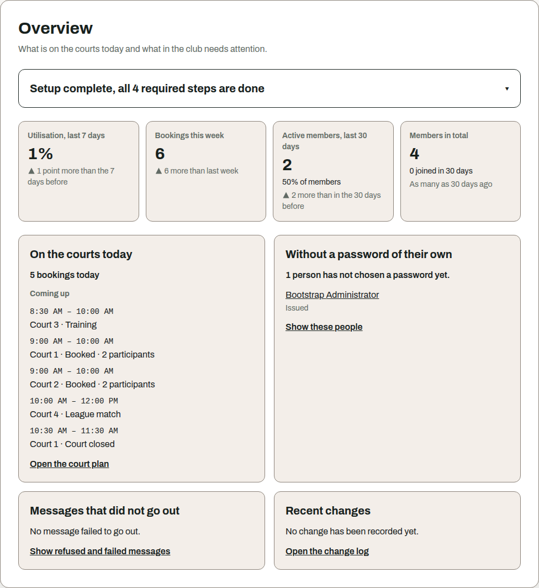

## Saving changes

Every administration page saves the same way. As soon as you change a field, a bar appears at the
bottom. It names the page or entry whose changes are not saved yet. *Save* commits every change on
the page at once. *Discard changes* restores what is stored.

Courtside saves the parts of a page in the order they appear there. If it refuses a part, the
message names that part. Everything before it is saved; the refused part and everything after it
stay in the bar until you correct them and save again.

If you leave a page with unsaved changes, Courtside asks first. This also applies when you reload or
close the tab.

Only actions that act independently of the rest of the page have a button of their own, for
example creating something, uploading or removing a logo, deactivating something or sending
credentials. Their label says what they do.

## The guided path: Setup

Open *Club → Setup*. The checklist checks the current state and marks every step as complete, open
or optional. A check mark stands for complete, an arrow for open and a circle for optional.

Complete the steps in this order:

1. **Configure the club.** Enter its name, colours, logo, language and time zone.
2. **Prepare the facility.** Add at least one enabled court and one open weekday.
3. **Offer membership types.** Connect membership types to booking rules and account rights.
4. **Add members.** Record at least one current membership.
5. **Import members.** This is only needed when another membership system holds the authoritative
   list.

You can leave the checklist at any time. Courtside recalculates its state when you return.

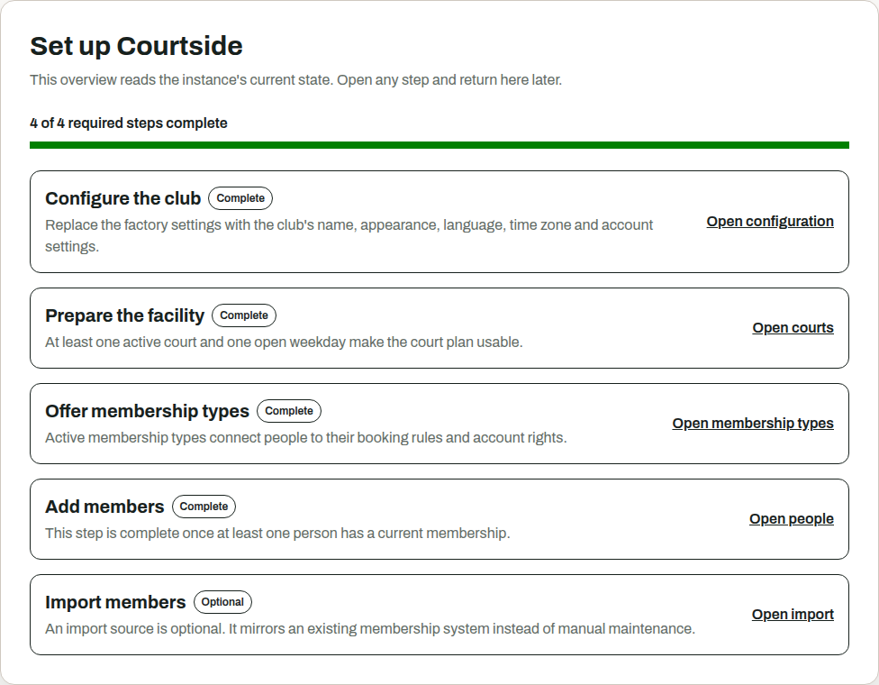

## Club → Club profile

Open *Club → Club profile* to edit who the club is and how Courtside presents it.

### Club and appearance

Enter the club name, primary colour, accent colour and logo. Courtside shows each colour's contrast
against light and dark text. Normal text requires a ratio of at least 4.5 to 1.

Logos must be PNG or JPEG files. The file may be at most 1 MiB and 2048 by 2048 pixels. An uploaded
file replaces the logo URL until you remove it.

A member who adds Courtside to a phone's home screen gets an app icon made from the uploaded logo.
A logo entered only as a URL is not enough for that, and the icon then shows the Courtside mark.
About twelve characters fit under the icon. Enter a **Short name** for it, or Courtside shortens
the club name to its leading words. The installed app's status bar takes the primary colour the next
time it opens.

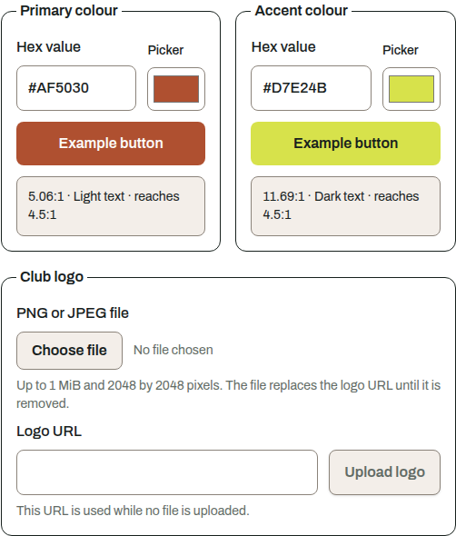

### Links, language and time

* Enter the club's own pages under **Imprint** and **Privacy policy**.
* Under **Documentation** you can link a guide of your own. Left empty, the footer link opens the
  Courtside documentation. The link is always visible, and the address you enter is readable
  without signing in, like the imprint and privacy links. Do not enter anything there that should
  stay private.
* The **Default language** applies to people who have not selected one.
* Enter a valid IANA time zone such as `Europe/Berlin`. You can only change it while there are no
  future bookings.
* The **Booking grid** determines the rows in the court plan and the permitted start times.

## Club → Deadlines and reminders

Open *Club → Deadlines and reminders*.

* Set **Reminder before a booking** to 0 to disable reminders. Any other value sets the interval in
  hours.
* Set separate lifetimes for one-time passwords issued to new and reset accounts.
* A password reset code may remain valid for between 15 minutes and one day. The member must
  request a new code after it expires.
* **Waitlist offer window** sets how many minutes a freed court stays reserved for the member whose
  turn it is on its waitlist. 15 minutes is the suggested value. The offer ends when the time starts
  at the latest. While it stands, other members and trainers cannot book the court, and their series
  skip that date. The board and a closure go first: when an admin books the court, creates a series
  over it or moves one onto it, or someone closes the court, the offer ends. The member sees this in
  *My bookings*.
* Under **Attendance** you switch recording on. Members then check in from 15 minutes before the
  start until the end of their booking in *My bookings*, and in an appointment that has started you
  record under *Appointments* whether its players came. A booking with nothing recorded never counts
  as a no-show. **Free the court after** cancels a member booking nobody checked in for 5 to 120
  minutes after its start and frees the court. Left empty, Courtside frees no court. The booker and
  the players receive a message when a court is freed. A freed court does not count as a no-show.

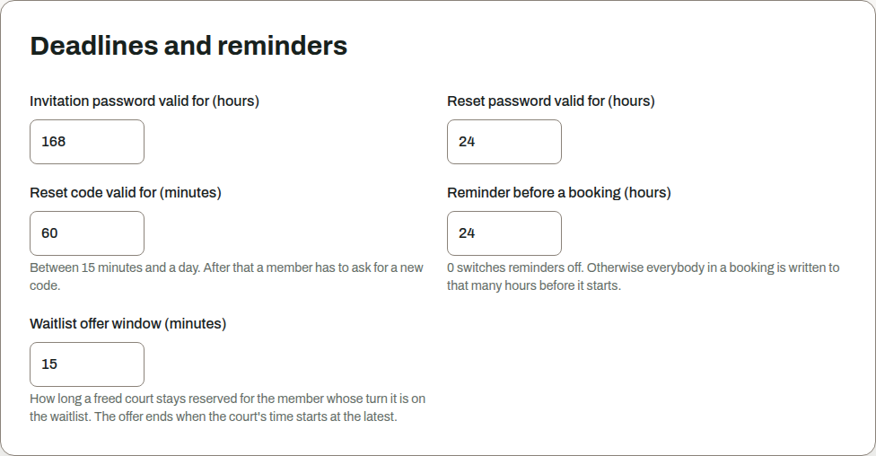

## Facility → Courts

A court needs a unique number and a name. Edit both directly in the list and save all changed
courts together.

Deactivate a court that the club no longer uses. It disappears from the court plan but remains in
past bookings and reports. Courtside notifies members whose future bookings are affected.

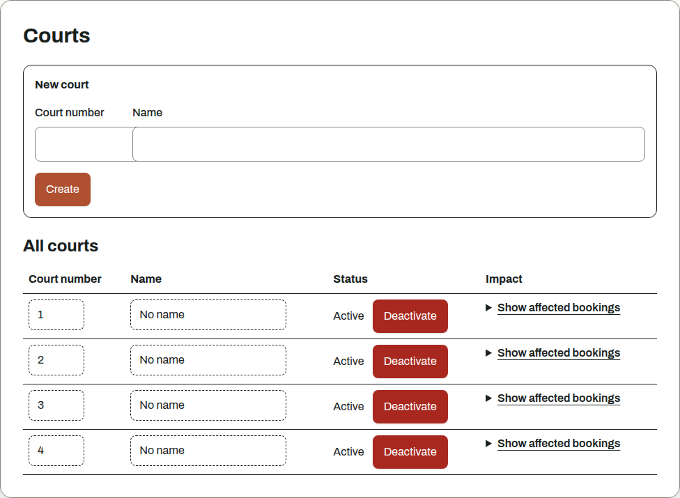

## Facility → Opening hours

1. Enter an opening and closing time for every open weekday.
2. Mark days without play as closed.
3. Use *Apply the same times* to copy one period to several days.
4. Under *Applies from*, choose the first day the week governs. It is today by default.
5. Save the week with the bar at the bottom.

A day in the future schedules the week in advance, such as winter hours from 1 November. Until
then the current hours stay. Past weeks always keep the hours they had. *Weeks* lists the week in
force and every scheduled one. You can edit a scheduled week, move it to another day or remove it.
You do not remove the week in force; you replace it from a day with a new one.

*Closed* is the wrong tool for a temporary closure. *Seasons, holidays and court closures* has
entries of their own for that, see the next section.

Courtside does not save a day when either time is missing. Members cannot book outside the opening
hours. If you shorten opening hours later, Courtside notifies members with affected bookings. Those
bookings stay and remain visible in the court plan.

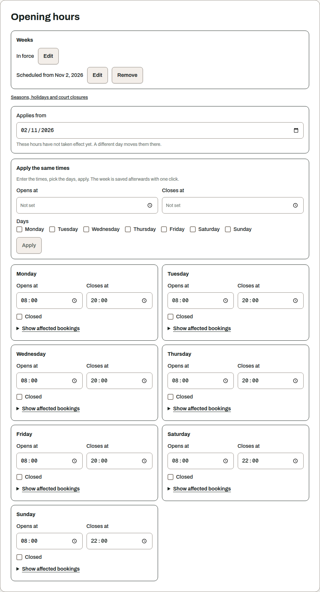

## Facility → Opening hours → Seasons, holidays and court closures

The link below *Weeks* leads to entries that govern a range of days.

- A **season** replaces the weekly hours from its first to its last day, with hours of its own
  for every weekday. Seasons do not overlap.
- A **holiday** governs before seasons and weekly hours. It has one window of its own or is
  closed all day. A new holiday starts with the weekly hours of its first day; it closes only when
  you tick *Closed*. A holiday may lie inside a season; two holidays do not overlap.
- A **court closure** takes one court out of the plan for whole days, such as a renovation. The
  other courts stay open. Two closures of the same court do not overlap.

An entry starts today or later. Until its first day you can change everything or remove it. Once it
has started, its first day and hours stay fixed; you can still rename it or end it earlier. Ended
entries stay as they were, so past days keep their hours.

Bookings already on a closed day stay. Courtside refuses new bookings and moves there. The court
plan names a holiday, and a closed court reads *Court closed*.

When an entry affects existing bookings, the form shows how many before you save. On saving, the
booker and the other players get a message in Courtside and by mail. It names the day, the court
and whether a holiday, a season or a closure is the reason, but not the name you gave the entry.
Whoever has been told hears nothing a second time when you extend the same entry.

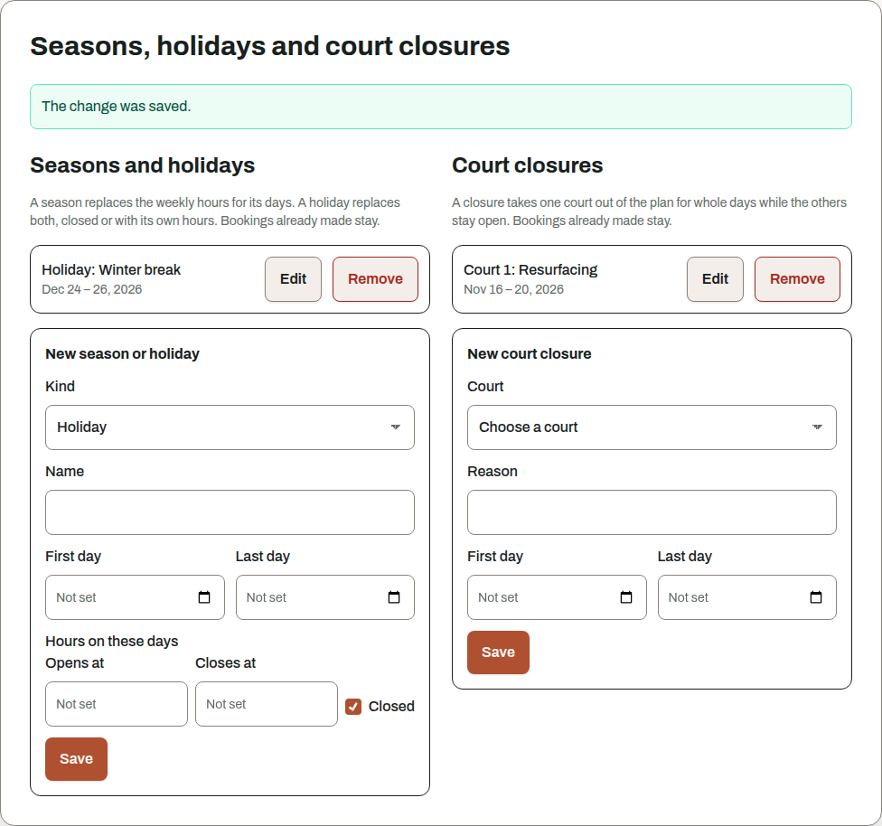

## Facility → Booking cards

Booking cards distinguish types of court occupancy, such as a member game, training, league match
or closure. Add one card for every type the club needs.

| Setting | Effect |
|---|---|
| **Label and colour** | Appearance in the court plan. Courtside shows the contrast of the label against the colour and warns below 4.5 to 1 |
| **Allowed roles** | Roles that may book with the card. With no selection, every signed-in person may book |
| **Managing roles** | Roles that may open, inspect and cancel every booking made with this card |
| **Allowed player counts** | Permitted participant counts. With no value, the card records no participants |
| **Counts against booking limits** | Counts the booking towards the member's open-booking limit |
| **Guests allowed** | Allows named guests |
| **Show neutral occupancy** | Shows *Occupied* instead of the card label in the public plan |

Administrators may use and manage every card. A booking with the *Court closed* card goes before a
reservation from the waitlist. If you clear its allowed roles, every signed-in person may close a
court and so end any waitlist offer.

A neutral display does not hide the label from
technical access because the public API still returns it. Do not use confidential labels.

Deactivate cards that are no longer needed. Existing bookings remain in place.

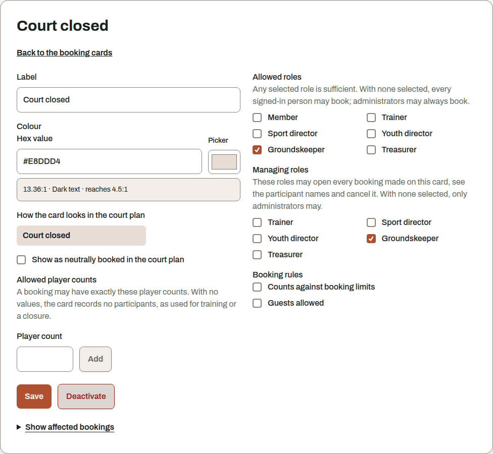

## Facility → Slot fillers

A slot filler occupies a player slot without representing a person. Examples include a ball
machine or a "looking for a partner" entry.

Enter a label and an optional available count. An empty count allows any number of simultaneous
uses. If all limited items are booked, Courtside refuses further selections for that period.

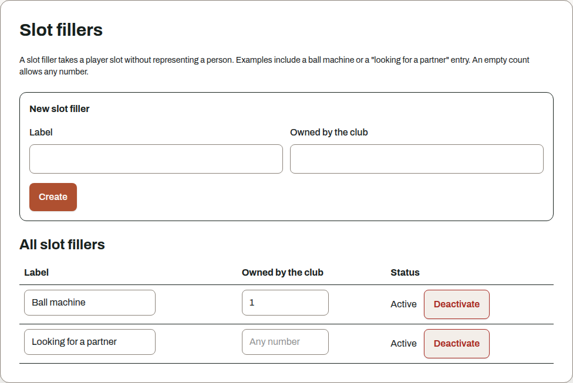

## Booking rules

Open *Club → Booking rules*. A membership type points to a rule set. The overview shows every rule set
with its state and the membership types it applies to. Choose a rule set there to edit its rules. The *In this rule set* box beside each rule decides whether the set contains it. Each rule set may contain these rules once:

| Rule | Setting |
|---|---|
| Advance booking window | Highest number of days in advance |
| Open bookings | Highest number of open bookings at the same time |
| Maximum booking duration | Highest duration in minutes |
| Cancellation deadline | Minimum number of minutes before the booking |
| Booking barred | Prevents members from booking and moving without another setting |
| Booking hours | Earliest start and latest end of a booking on every weekday |
| Weekly booked hours | Highest number of hours a member may have booked from Monday to Sunday |
| Minimum booking duration | Shortest duration in minutes |
| No-shows | From this many recorded no-shows over the last days Courtside takes no booking of the member |

Opening hours and the booking grid apply across the club, so they sit outside rule sets. Booking
hours narrow the opening hours for one membership type and never widen them. With the facility
open until 23:00, for example, a youth rule set can allow bookings until 20:00. Like the opening
hours, booking hours end at 23:59 at the latest. For a window that lasts until closing, enter the
facility's closing time as the latest end. The weekly booked hours count the confirmed bookings a
member booked, by the week they start in. Cancelled bookings and booking kinds that do not count
against limits, such as training or closures, stay out. Administrators may override the booking
prohibition, the booking hours, the weekly booked hours and the minimum duration for
administrative work. Time and court constraints still apply to them.

Retiring a rule set does not stop it from applying to membership types already assigned to it. It
only removes the set from new selections. Assign another rule set first if the affected members
should receive different rules.

Below the overview, select a rule set for people without a current membership type if
membership-related rules should still apply to them. Opening hours and the booking grid apply even
without this selection.

The selected rule set's name and rules and the rule set for people without a membership type are
saved together. If you choose another rule set before saving, Courtside asks first, because the name
and the rules belong to the selected set.

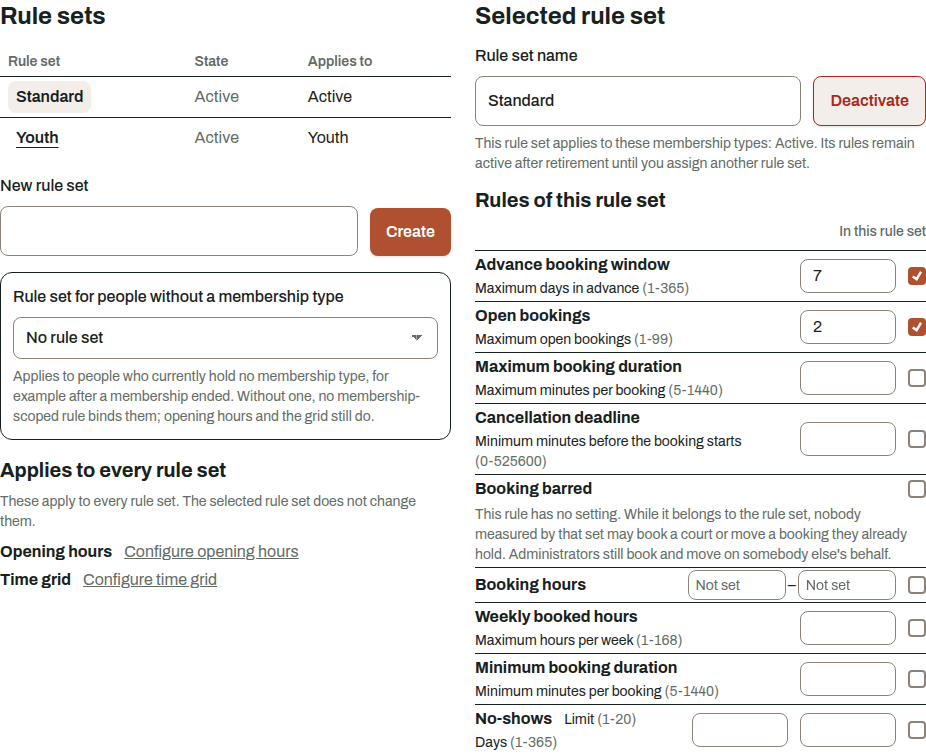

## Club → Message wording

Open *Club → Message wording*. Courtside ships every message in German and English. Here you give a
message your club's own subject and text.

* Choose the **Message** and the **Language**. The page says whether the shipped wording or your own
  applies.
* The list below names the placeholders this message fills, such as `{firstName}` or
  `{instanceLink}` for the address of your Courtside. Placeholders marked *(required)* must stay in
  the text: the username and one-time password, the username and code. A one-time password or code
  may not appear in the subject and stands on its own in the text, separated by spaces, so it never
  becomes part of a link. The subject stays on one line.
* *Preview* fills your draft with example values and stores nothing.
* *Save wording* may ask for your password once more, because the wording also covers messages that
  carry sign-in details. The next message of this kind and language uses it.
* *Restore shipped wording* removes your wording for that language.

The wording changes only what a message says. Who receives it, whether it is sent and whether a
member may switch it off stay the same. If Courtside cannot fill a stored wording when it sends the
message, the shipped wording goes out. Every change appears in the change log.

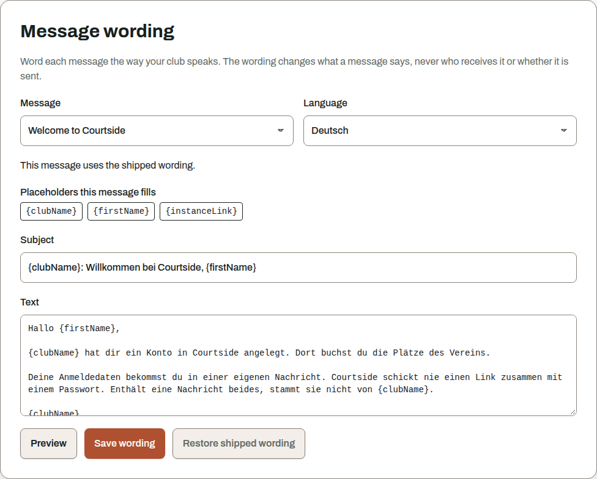

## People → Membership types

A membership type has a label, a rule set and an import setting. The overview shows each type in
one row, or one card on a phone, so the rule sets of all types can be compared one below the
other. *Edit rules* opens exactly the rule set the type uses.

Enable **Open an account on import** if imported members of this type should receive an account.
Courtside sends a welcome message and then the one-time password to the recorded email address.
Existing accounts remain unchanged.

Retiring a type preserves existing assignments and booking rules. The type can no longer be
assigned to new memberships.

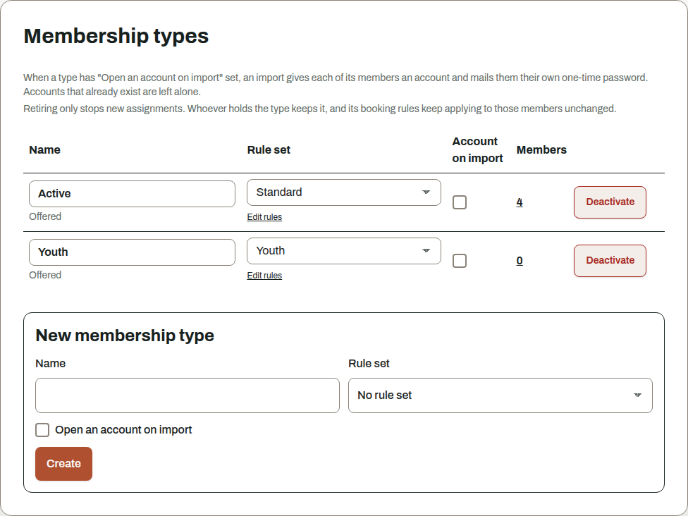

## People → People and accounts

Add a new person at the top. Below it, the overview shows name, username, account state, access,
membership type and roles, together with the number of people the search and filters match. A
disabled account carries a colour and a mark of its own. The access column says whether credentials
have not been issued yet, are issued or have expired, or whether the member has chosen a password of
their own. The **Access** filter set to **No password of their own yet** lists everybody who has not
chosen one yet. On a phone, sort with **Sort by** and **Order**. You can correct first name, last
name and email address later.

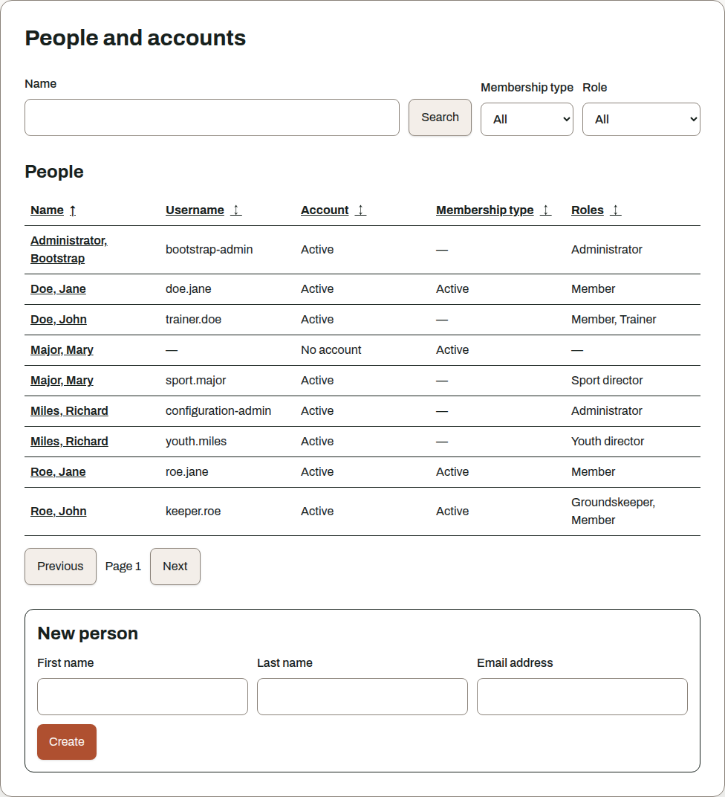

After opening a person, you can edit these areas:

* **Person** contains first name, last name and email address.
* **Membership** contains type, start and end. End a membership instead of deleting it. You can
  correct the end date later. The end is the first day the person is no longer a member.
* **Membership periods** lists every period of this person, including a change of type or a
  return. A period may begin in the future and holds from its first day only. Two periods may not
  overlap. Correct or remove a period recorded by mistake there.
* **Account** contains username, the language used for notifications, roles, state and credentials.
  An account requires an email address.

### Send credentials

Before sending, Courtside shows the destination address and warns about shared addresses. The
one-time password goes directly to the member and is not displayed to the board. A new account
receives a welcome message first; new credentials for an existing account do not.

New credentials replace an existing password and end every session for the account. Only use this
function when the member cannot recover the account without help.

Administrators can change an email address and then request new credentials. The change log records
both actions with their time and acting account, but it records neither the address nor the
password. Organisational controls, such as sharing responsibility between several people, remain
the club's responsibility.

### Lift no-shows

For a person with an account the **No-shows** section lists the recorded no-shows that still count.
**Lift the no-shows** keeps them recorded but stops them counting, which ends the block of the
*No-shows* rule. A no-show recorded later counts again.

### Deactivate an account

Deactivate the account when a person should no longer have access. Courtside ends every session.
Bookings and reports remain intact. You can enable the account again later.

### Export one person's data

*Answer a data access request* creates a file containing data about this person. It includes person
and account details, membership, bookings with the time an open place was offered, series, the
person's own waitlist entries and the waitlists that name them, messages, notification entries with
the booking or waitlist entry each concerns, opt-outs, import references and related change-log
entries. Inspect the file before sharing it. Creating the file is itself written
to the change log.

You can export the whole people list as CSV. It may also include member numbers from one import
source.

## People → Import

Use the import when another membership system holds the club's authoritative list. The process has
three stages: source, preview and execution.

### Example acceptance run

The [complete example file](/examples/roster-import-example.csv) contains 24 fictional people:
18 adults and 6 juniors. The
[changed example file](/examples/roster-import-example-update.csv) contains 23 of those people.
It changes the email address of `EX-1001`, assigns `EX-1002` to the `Junior` category and omits
`EX-2006`. Every address uses the reserved `example.org` domain.

Prepare a fresh test instance for a repeatable run:

1. Create active membership types named `Adult` and `Junior`. Enable *Open an account on import* for
   both when the run should also exercise account creation.
2. Create an import source named `Acceptance example` with UTF-8 and a semicolon separator.
3. Map the columns as follows:

| CSV column | Courtside field |
|---|---|
| `Member number` | Member number |
| `First name` | First name |
| `Last name` | Last name |
| `Email` | Email address |
| `Category` | Category |

4. Map `Adult` to the membership type with that name and `Junior` to the membership type with that
   name. Mark first name, last name, email address and category as fields owned by the source.

Run the files in this order:

| Step | File and mode | Expected result |
|---|---|---|
| First import | complete file, complete list | The preview shows 24 new people, 18 `Adult` and 6 `Junior`. With account creation enabled, it plans 24 accounts. After execution, a roster that previously contained only the administrator account contains 24 additional people. |
| Repeat | complete file, complete list | The preview contains no person change, new membership or new account. |
| Partial list | changed file, partial list | The preview changes two people. `EX-2006` keeps an active membership because a partial list ignores missing rows. |
| Restore the baseline | complete file, partial list | The two changed values return to their original values. All 24 imported memberships are active in their original state. |
| Complete list | changed file, complete list | The preview changes two people and warns about one ending membership. After execution, all 24 people remain stored and 23 have an active membership. The member-only account belonging to `EX-2006` is disabled. |

Run the last step only on a test instance. A later import does not automatically enable an account
or restore a member role removed by a complete-list import.

### 1. Describe the source

Enter the label, separator, character set and column mapping. Map external categories to membership
types in Courtside.

Mark the fields that this source should own. Every later import overwrites owned fields on existing
people. Unmarked fields remain unchanged. New people still receive every mapped value from the
file during their first import.

Review this choice carefully for the email address. Courtside sends one-time passwords and account
recovery codes there.

The example file used for mapping stays in the browser and is not uploaded.

If your export has no header row, choose *By position*. Courtside then shows the first rows of the
example file in numbered columns, and you give each field a column number. The form takes the
number of columns from the example file. If the browser cannot show the character set, you enter
it yourself. If the first row looks like a header, the form says so, because read by position it
would be imported as a member.

Courtside refuses a file with a different number of columns before it reads a single row. That
way no value lands in the wrong field when the club software adds or drops a column. If you switch
a saved source to the other way of reading, the form asks before it saves. The next file is then
read the new way.

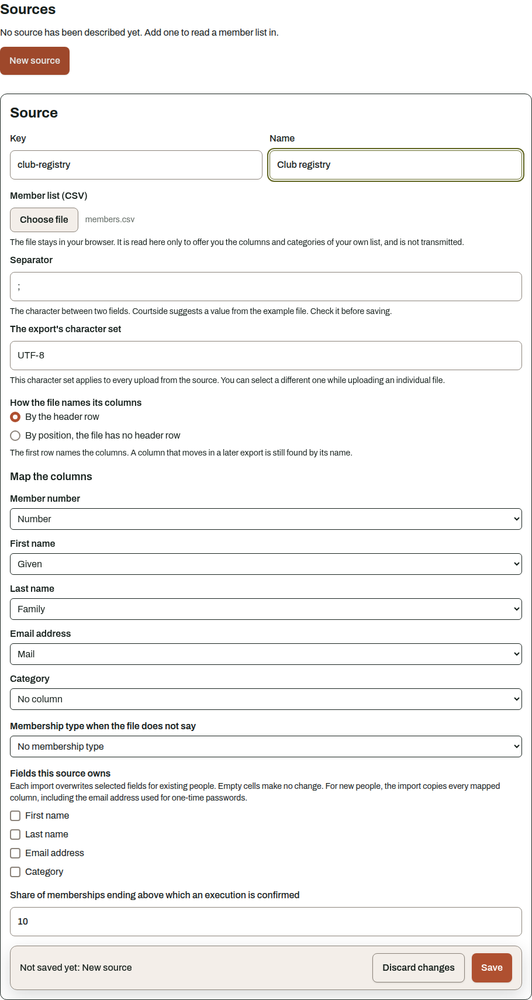

### 2. Review the file

An upload first creates a preview and does not change any person. The preview shows the file name,
row count, checksum, changes, skipped rows, possible duplicates, shared email addresses and planned
accounts.

Courtside does not store the file itself. It keeps the calculated changes, including names,
addresses and member numbers, until the preview expires.

Choose the correct mode:

* A **partial list** only changes people contained in the file.
* A **complete list** ends memberships whose rows are missing. Accounts with only the member role
  are deactivated. Accounts with additional roles remain enabled but lose the member role. Both
  cases end their sessions.

An import identifies people only by source and member number. Link people who already exist before
execution, or the import will create duplicates. Review similar names and shared email addresses by
hand.

### 3. Run the import

Review the summary and select *Run import*. If the share of ending memberships exceeds the source's
threshold, Courtside requires another confirmation. It saves the complete set of changes in one
database transaction.

A later correct import does not automatically reactivate accounts or restore removed member roles.
After importing an incomplete file by mistake, enable affected accounts and assign their member
roles again.

## Records

The **Records** area has eight views. The next section describes *Retention*.

* **Statistics** opens on the last full month. At the top you choose another period: 7 days, 1, 3,
  6 or 12 months up to today, everything since the first booking, the previous calendar year or two
  dates of your own. The period is part of the page address, so a bookmark opens the same figures
  again. Every key figure states its change against the equally long period before. All figures
  are totals and name nobody.
  * Utilisation shows occupancy, booked and closed time, the progression week by week or month by
    month, a table by weekday and hour, and the figures per court and per booking card. Occupancy
    is booked time divided by open time without closures. Each day uses the opening hours in force
    on it. Time played outside the opening hours does not count.
  * Booking behaviour shows confirmed and cancelled bookings, the cancellation rate, series and
    single bookings, guests and the slot fillers used.
  * Members shows the members at the end of the period, joins, leavings, active members, membership
    types and accounts. An active member holds a membership at the end of the period and booked or
    was entered into a confirmed booking within it. For periods whose bookings have been
    pseudonymised, this figure is unavailable.
  * Messages counts per kind how many are in progress, handed over, refused or failed.
* **Usage** answers four questions for a period, by default the last full month, or for two dates
  of your own. It counts the bookings that start in the period and names nobody.
  * Capacity shows which booking card and membership type took how much of the open court time.
  * Cancellations splits into those by the member, by the club and the bookings released without a
    check-in. The club's cancellations appear by the reason it gave.
  * Attendance counts attended bookings, no-shows that still count and lifted ones. A booking with
    nothing recorded counts in none of them.
  * Refused by the rules counts the booking, series and cancellation attempts the rules refused,
    by rule.

  A card or membership type fewer than three members stand behind never appears on its own line.
  It joins *Other*, so the totals stay whole and nobody can be read from a small group.
* **Data export** creates CSV files for bookings, members, the change log and the message log. You
  pick the separator and character set for each download; the import source's settings stay as they
  are. The booking export omits the person who booked. The member export contains personal data and
  creates no change-log entry. Without a period the two log exports hold every entry up to the
  moment of the download, with names as the log views show them. Each log export appears in the
  change log with "Whole instance" as its subject. A value starting with `=`, `+`, `-` or `@` gets a
  leading apostrophe, so the spreadsheet reads it as text and runs no formula.
* **Change log** lists administrative changes with time, subject and acting account. A booking
  appears as its courts and its current time, a series as its courts and its current first
  appointment, even for an entry recorded before a later move. Search by a subject name, a court
  name or a username and narrow the result by kind of change and time range when needed. *Load
  more* keeps the active filters; *Clear filters* returns to the complete log.
* **Message log** shows delivery state. *Handed over* only means that the mail server accepted the
  message. Final delivery is recorded by the mail server, not Courtside.
* **Operational log** shows recent records from the application, database and reverse proxy after
  pre-storage redaction. Filter by reported source, severity, club-local time, message or trace ID. Warnings
  about unavailable, expired or incomplete evidence are part of the result. The view is not a
  durable log archive and cannot inspect arbitrary server containers. The source is not
  authenticated: a local process on the server can imitate one of the fixed source names.
* **Operator health** shows what the instance can prove about itself: version, database schema,
  mail handover, public address and latest backup. Each check is *Healthy*, *Failing* with the place
  that fails, or *Not evidenced*. Not evidenced does not mean healthy. It means Courtside holds no
  evidence. The latest backup stays not evidenced until the operator records its time. The view
  checks when it opens and when you press **Check again**. It raises no alarm on its own. A warning
  about a backup that is too old belongs in the operator's own monitoring.

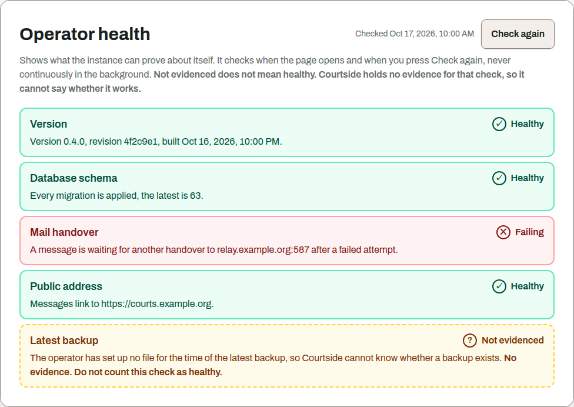

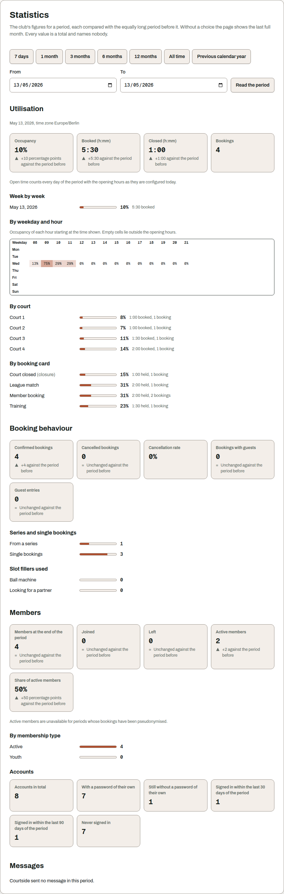

## Records → Retention

Here the club decides how long it keeps personal records after they end. Courtside sets no period.
A category without a period stays untouched, however old its records are. Which period is lawful
is the club's decision as the controller. The [privacy kit](privacy-kit.md) helps to document that
decision but is no legal advice.

There are two categories, each with a period in months from 1 to 1200:

* **Bookings** pseudonymises bookings and series that ended before the period. Bookers, the
  accounts that cancelled or moved them, notes, member players and guest names disappear. Card,
  courts, times, status and the number of guest places stay, so utilisation, usage and booking
  counts keep counting these bookings.
* **Former members** removes a person whose membership ended before the period and whose accounts
  have neither signed in nor been opened since. Their accounts and everything attached to them go
  with them.

Before you set a booking period, know what you lose: for pseudonymised periods the statistics no
longer count active members, and usage can no longer attribute that capacity to a membership type.
A departure is not handled by retention: a member who leaves is recorded with *End membership*,
and only the period removes the person later.

A run always starts with *Create preview*. The preview changes nothing. It counts how many
bookings, series, former members and accounts a run would cover now and names the people it cannot
reach yet, with the reason:

* An account of the person holds the *Administrator* role.
* A booking or series that stays still names the person.
* The person is waiting for a court.

*Open person* takes you to that person so you can resolve the reason. Only after you confirm in the
form that the run cannot be undone does *Run for good* apply exactly that preview. Without a fresh
password proof Courtside asks for your password. A preview is valid for 30 minutes, only the
account that created it can run it, and it runs at most once. Anybody who signed in again since the
preview is skipped and counted. The change log records the periods and the figures of a run, never
the names.

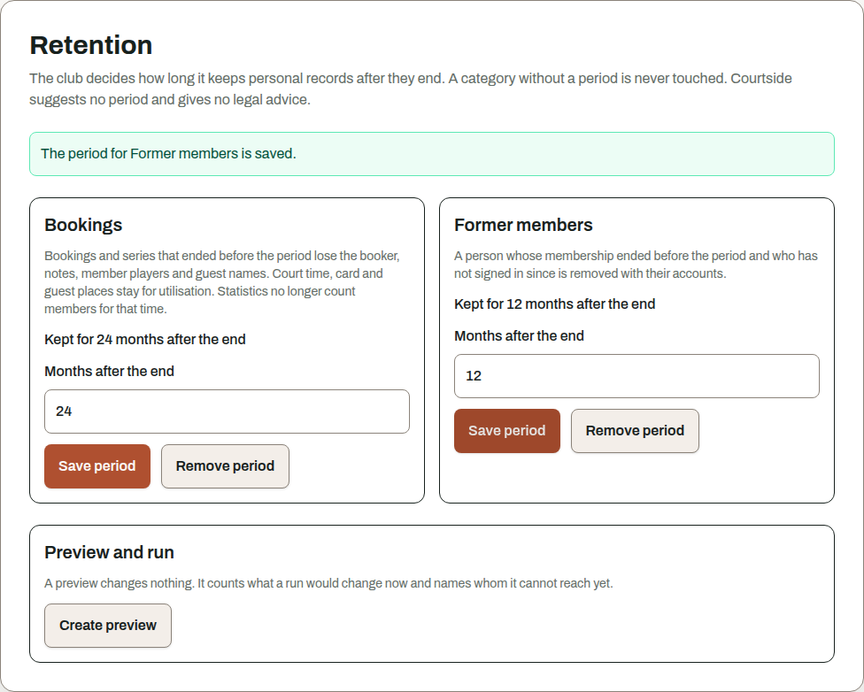

## Two rules that hold everywhere

Courtside keeps the domain history. Deactivate or retire courts, booking cards, rule sets,
membership types and accounts. End memberships. Do not delete these records if past activity must
remain traceable. Only *Retention* removes personal records once a period has passed.

Input mistakes remain correctable. Edit names, usernames and dates in the relevant administration
page. No direct database access is needed.

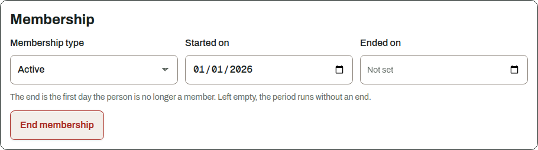
