# Member handbook

This handbook explains the features you need as a member. Button and menu names appear in
*italics*. Your club sets its own opening hours, deadlines and limits.

## The court plan is public

The home page shows the court plan without requiring you to sign in. A wide screen shows one week.
A narrow screen shows one day. Signed out, a notice above the plan offers *Sign in*, which you need
before you can book.

1. Use *Choose date* to jump straight to a day, across weeks as well.
2. Select *Previous week* or *Next week* to step through the periods.
3. Select *Return to current time* to return to today. This works from any period.
4. Use the legend to identify **Available**, **Occupied**, **Your booking**, **Unavailable** and
   **Past** periods.

Courtside does not show a grid on days when the club is closed; on a holiday its name appears
above the plan. A closed court reads *Court closed* in its column. A booking outside the opening
hours, for example after the club changed them, stays visible in the plan. The other courts in its
rows read *Closed*. Another member's booking displays
either its booking type or the neutral label *Occupied*. The club chooses this for each booking
type. The number of participants is public, but their names are not. You only see names on your
own bookings.

On a narrow screen a booking shows only a short form of its booking type. The legend gives the full
name for each short form. Your own bookings also carry a person symbol.

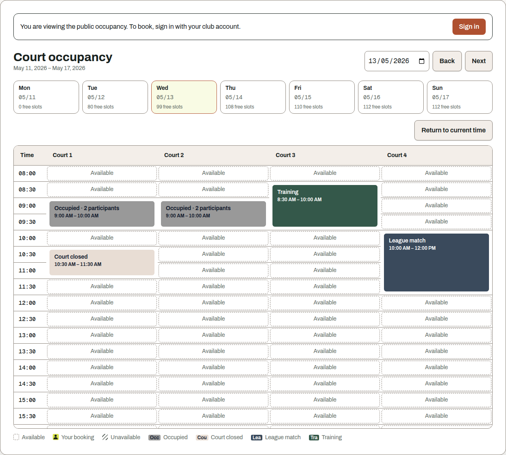

## Signing in

The board creates your account. Courtside first sends you a welcome message, then the username and a
one-time password in a separate email. Nobody on the board sees or chooses that password.

1. Select *Sign in*.
2. Enter your username and password.
3. Select *Sign in* again.

If you opened a link to a page in Courtside, such as one of your bookings, Courtside takes you there
after you sign in. This also applies when you first have to replace your one-time password. If your
session ends while a page is open, the next sign-in also takes you back there.

### The second step

If you set up two-factor authentication, Courtside asks for a second proof after your password. This
applies to every sign-in in every browser.

1. Enter a code from your authenticator app or an unused recovery code.
2. Select *Sign in*.

With a security key or passkey, select *Use security key or passkey* instead and confirm your
browser's request. The second step allows five minutes and five attempts. After that, start again
with your password. *Sign in with another account* abandons the second step. If you have none of
your factors left, *Lost your second factor?* leads to controlled recovery.

Check the values first if Courtside refuses the sign-in. Your credentials may have expired, or the
email may not have arrived. In either case, use *Forgotten your password or username?*. Only the
board can reactivate a deactivated account.

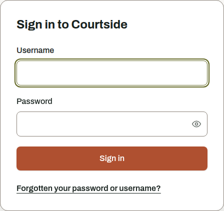

## Forgotten password or username

Account recovery does not require you to sign in. The page has four separate forms.

### Request a code

1. Enter your username.
2. Select *Send code*.
3. Open the email containing the eight-character code.

Your current password remains valid. Open sessions stay signed in.

### Redeem a code

1. Enter the code from the email.
2. Choose a new password.
3. Select *Set password*.

Only the new password works afterwards. Courtside ends every open session for the account.
Two-factor authentication stays in place if you set it up. A
rejected password does not consume the code. The code is not case-sensitive, and you may omit its
hyphen. Request a new code if the old one has expired.

### Request your usernames

Enter your email address and select *Send usernames*. Courtside sends a separate message for every
account registered to that address. Passwords remain unchanged.

Courtside gives the same response when a username or address is unknown. This prevents visitors
from using the form to search for accounts. If no email arrives, check the username and the inbox.
Ask the board if you still cannot recover the account.

### Lost every second factor

If you lost your authenticator app, your security keys and your recovery codes, only the club can
help. Contact the board and have your identity verified. The board then starts controlled recovery.
From that moment every session of your account ends. Sign-in and ordinary password recovery stay
blocked. Courtside sends a time-limited code to your registered address.

1. Enter your username and the code from the email.
2. Enter a new password twice.
3. Select *Recover account and set password*.

Courtside removes every previous factor and recovery code. Sign in with the new password and set up
two-factor authentication again. If your email address changes first, the code stops working and
the board has to start recovery again.

Too many attempts cause a waiting period. Sign-in and code redemption count attempts from the
shared internet connection. Code requests also count the submitted username or address. Other
people on the same network can therefore reach the same limit. Your current password remains
unaffected.

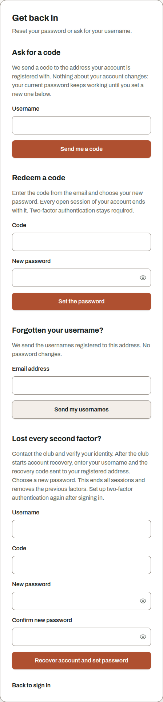

## Replacing the one-time password

A one-time password is only for first access or an account reset by the board. After signing in,
Courtside opens *Replace one-time password*. Other features remain unavailable until you set your
own password.

1. Enter the new password twice.
2. Select *Save password*.
3. Sign in again with the new password.

The password must contain between 12 and 256 characters. Courtside rejects common passwords and
passwords containing your name, username, email address, the club name or a term blocked by the
club. It must also differ from your current or issued password.

Courtside asks a public service whether the password appears in a known data breach. Only the first
five characters of a checksum leave the instance. The service does not receive your password. If
the check is unavailable, Courtside does not save the password. Try again later.

The eye in a password field shows what you typed. Selecting it again masks it.

If the one-time password has expired, request a code from the sign-in page. You can use that code
to set a new password yourself.

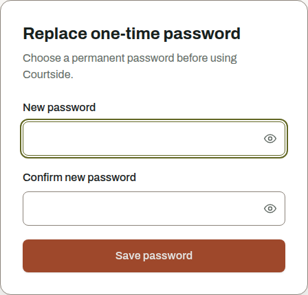

## Creating a booking

1. Select an available cell in the court plan. This sets the court and start time.
2. Choose an allowed **Duration**.
3. Choose the **Booking type**.
4. Add members if needed.
5. Open *More details* to add guests, slot fillers or a note.
6. Select *Book now*.

A normal member account books the selected court. Accounts with additional roles may choose
several courts, for example for a training session.

The database checks that the court is still available when it saves the booking. If somebody
booked the same period moments earlier, Courtside refuses your request. It never creates two
bookings for the same court and time.

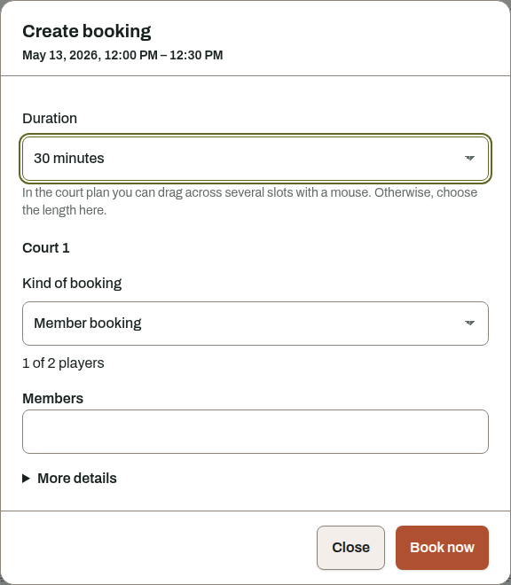

## What a kind of booking means

A booking type controls how Courtside handles an occupancy. It may represent a game, training,
league match or closure.

The booking type determines:

* how many people can be recorded,
* whether guests are allowed,
* whether the booking counts against your open-booking limit,
* which roles may use the booking type.

The board configures the booking types. The booking dialog only offers the types you may use.

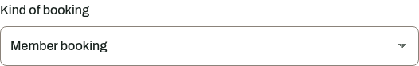

## Players and guests

The booking dialog shows how many player slots are already filled.

* Search for **Members** by name and add them. Each member can occupy only one player slot in a
  booking. You hold a slot yourself as the booker, so the search does not offer you.
* Enter **Guests** by name under *More details*. The field only appears for booking types that
  allow guests.
* Under ***What plays***, select a slot filler such as a ball machine or a "looking for a partner"
  entry. Courtside reports when none are available at the chosen time.

Recorded members receive an email. They do not need to accept the booking and can remove
themselves later.

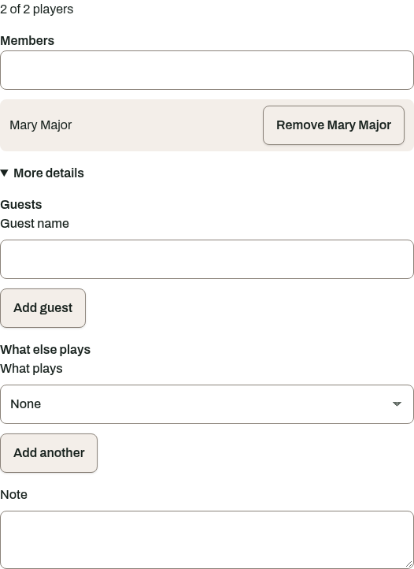

## Recorded as a co-player

Open *My bookings* and go to **Recorded as a co-player**. This section lists bookings that other
members created with your name.

Select *Withdraw* to remove yourself. The booking remains in place. Courtside notifies the person
who created it. A cancelled booking stays listed as cancelled and offers no withdrawal.

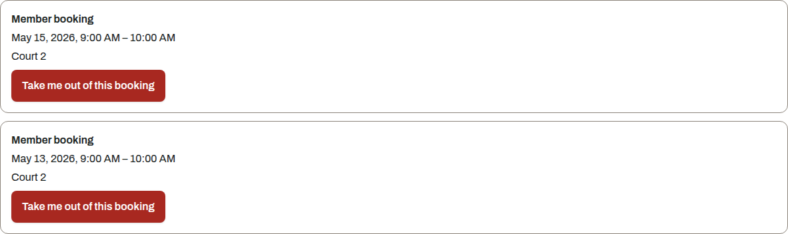

## Looking for a partner

When your booking holds the "Looking for a partner" slot filler, *My bookings* shows **Look for a
partner** on it. That offers the place to other members. **Stop looking** withdraws the offer. A
series and a booking that has already started offer no place.

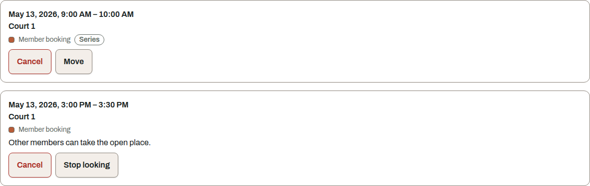

Other members see offered places in *My bookings* under **Open places**: the time, the court and the
booking type, but no name. A place is shown only to members who may book that booking type and do
not play in it yet. Whoever selects **Take the place** then plays in the booking in place of the slot
filler. Only one member takes the place, even when several try at once.

A message tells you who took your place, and tells the member when and where they play. Both
messages can be switched off. The offer ends when the booking is cancelled or starts.

## When a rule refuses the booking

Your membership type determines which booking rules apply to you. Courtside shows all detected
violations at once next to the relevant fields.

| Message | Meaning |
|---|---|
| The facility is closed on this day | The day has no opening hours |
| Bookings are only possible between two times | The booking is outside the opening hours |
| Court 2 is closed until a date | The club has closed the court on that day |
| Your membership type may book only between two times | Your membership type may book only part of the opening hours |
| Bookings start on the minute grid | The start does not match the club's grid |
| The duration must be a multiple of the grid | The duration does not match the grid |
| You can only book a certain number of days ahead | The allowed advance period was exceeded |
| A booking may only last a certain number of minutes | The selected duration is too long |
| One booking must run at least a certain number of minutes | The selected duration is too short |
| You may book at most a certain number of hours a week | With this booking you would have booked more hours from Monday to Sunday than your membership type allows |
| You did not turn up to a number of bookings in the last days | The club takes no booking until the board lifts the no-shows |
| You have reached the number of open bookings | You must finish or cancel an open booking first |
| You must cancel a certain number of minutes before the start | The cancellation deadline has passed |
| A booking cannot start in the past | The selected start is in the past |
| Court booking is not available to you | Your membership type cannot book courts directly |

The message includes the applicable number. Correct the marked fields and submit the booking again.

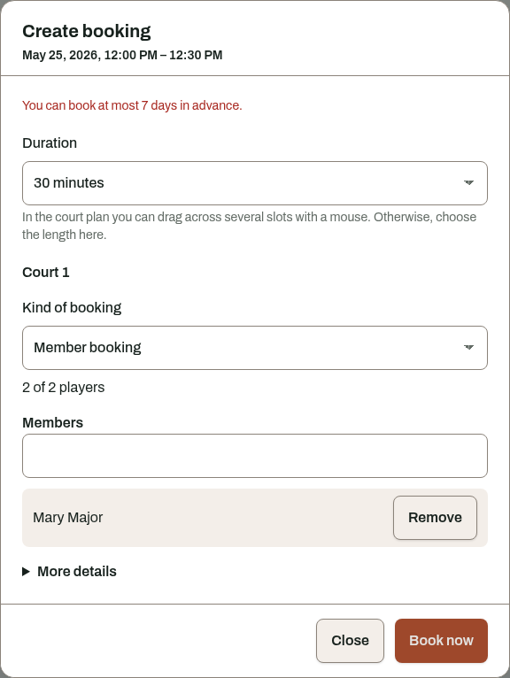

## Cancelling

1. Open *My bookings*.
2. Select *Cancel* on an upcoming booking.
3. Confirm the cancellation.

Courtside releases the court immediately. If the cancellation deadline has passed, the booking
remains and Courtside tells you which deadline applied.

Until its date, the cancelled booking sits in the folded section of cancelled bookings below your
upcoming ones, so it never pushes a booking that still stands down the list. After its date you
find it among your past bookings.

Members recorded as players in the booking learn of the cancellation. If the club cancels your
booking, you learn of it as well. If the club chose a reason, the message names it. Otherwise ask
the club.

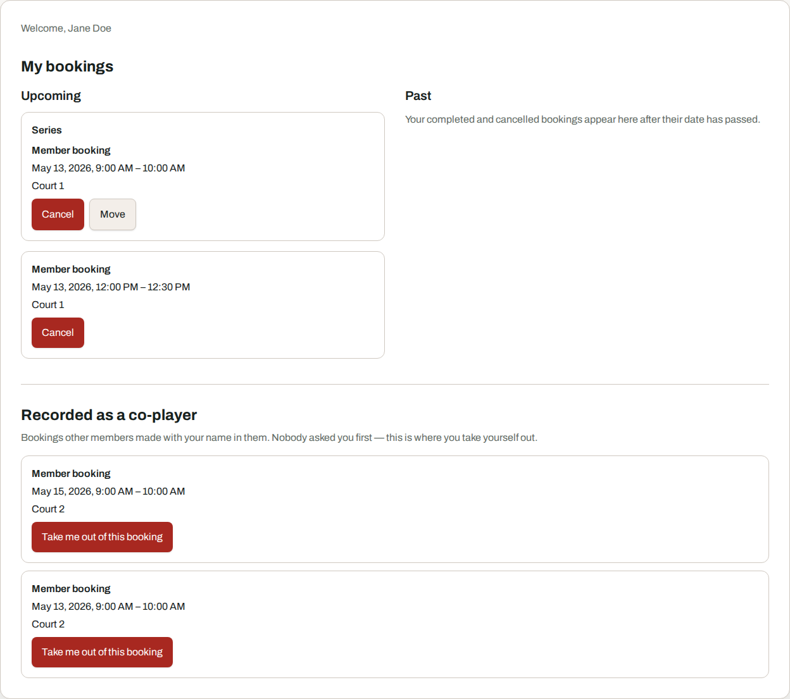

### Checking in

If your club records attendance, you check in under *My bookings* with **Check in** from 15 minutes
before the start until the end of your booking. If the club has set a release time and nobody
checks in by then, Courtside cancels the booking and frees the court. It then shows as freed among
your cancelled bookings. You and every player of the booking receive a message about it. Only the
member who booked can check in.

## Waiting for a taken court

If a court is taken at the time you want, you can join its waitlist.

1. Select the taken time in the court plan.
2. Choose the kind of booking and your players as for a booking.
3. Select *Join the waitlist*.

Courtside checks the same rules as for a booking. Each court and time has its own waitlist. Whoever
joins first is offered the court first.

When the court frees, Courtside reserves it for the first member on the waitlist. Your offer appears
in *Messages* and in *My bookings*, and by email only if you chose email. The reservation lasts
as long as the club has set, at most until the time starts. Select *Book* to turn it into your
booking with the players you named. If you decline or the time runs out, the court goes to the next
member. If you may no longer book the court or your mail server refuses the message with the offer,
Courtside skips you. If the club takes the court itself, for a closure for example, your offer ends.

*My bookings* lists only your own entries. Courtside shows nobody who else waits or where you stand.
You can leave a waitlist at any time. Your entry ends when you book the court yourself or its time
starts. On one court you can wait for only one of several overlapping times. You can hold at most 20
entries whose time has not passed yet. Entries you left or that ended without a booking count too.
An entry that became a booking you still hold on that court and time does not.

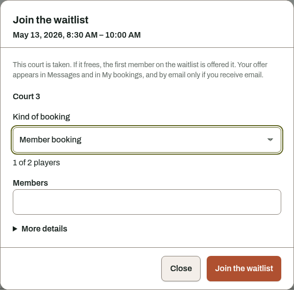

## Series

Accounts whose role an active booking card without a player list allows can create a series under *Administration → Club appointments*. A series creates normal
bookings from a schedule. You set the first date, time, duration, weekdays, interval in weeks and
the end of the series.

Keep these rules in mind:

* Courtside skips dates that are already occupied and creates the remaining bookings.
* When cancelling or moving bookings, you can choose *This occurrence*, *This and following* or
  *Whole series*.
* Before a move, Courtside shows the affected bookings and any conflicts.
* A series contains no player list. It appears as occupied time in the court plan.
* Once the series exists, the form closes and one summary above the list replaces a confirmation
  per date. It also names the skipped dates.
* If the club cancels or moves dates of your series, you receive one message covering all of them.

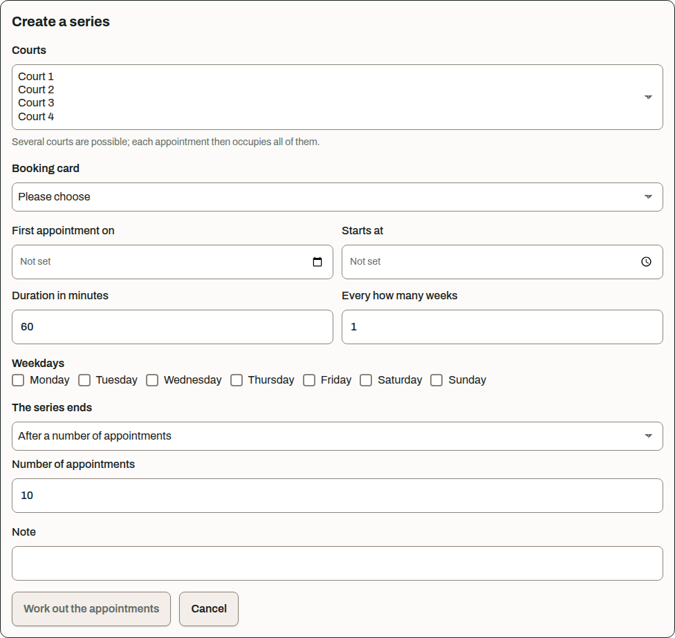

## When something under your booking changes

A later configuration change may affect your booking. Examples include a deactivated court, a
retired booking type or shorter opening hours.

Courtside tells you the reason under *Messages*, and by email if you chose email. This does
not cancel the booking automatically. The club
decides how to handle it.

## Messages

*Messages* lists every message Courtside sent you, newest first. Each entry shows when it
arrived, what it concerns and whether you have read it. New entries are marked *New*. The link
below an entry opens the booking it concerns or your account security. Select *Mark as read* or
follow the link to mark an entry read. You see only messages addressed to you, even without an
email address. The number beside *Messages* in the menu counts the unread entries.

Below the list you choose what you receive. You can disable:

* booking confirmations,
* reminders before a booking,
* messages when somebody withdraws from your booking,
* messages that the member who booked cancelled a booking you were recorded in,
* the summary of a new series.

A disabled message no longer reaches you at all, neither here nor by email.

Courtside always sends:

* credentials for a new or reset account,
* notice that somebody added you as a player,
* notice of a change that affects your booking,
* notice that the club cancelled a booking that concerns you,
* notice that the club cancelled or moved dates of your series,
* an offer from a waitlist you are on. Leave the waitlist to stop it.

Separately, you choose whether you also get an email. Without email your messages still appear here.
You then learn only here that somebody added you as a player, that a change affects your booking or
that the club cancelled one. Courtside always emails credentials, your username and reset codes,
because you are not signed in when you need them.

When your club has set up Courtside's address, an email about a booking ends with a link. It leads to
the booking or to *My bookings*, and a waitlist offer leads to your place on the waitlist. The
calendar entry of a confirmation carries the same link. The welcome message ends with a link to
Courtside's start page.

Courtside puts no link into emails with credentials, your username or a reset code. Some mail
programs still make something clickable, such as a club name that looks like an address. Do not
follow a link there, open Courtside at the address you know. Texts your club wrote itself may
differ from this rule.

Save your choices. They apply to future messages only.

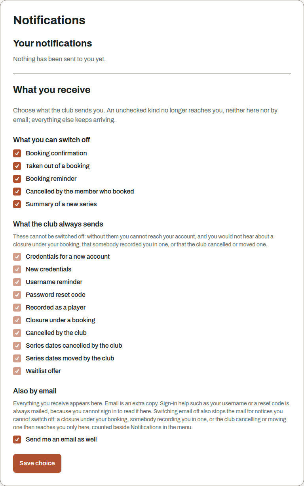

## Your account

Your username appears by the *Account and appearance* menu. Open *My account* there.
The *Profile* section shows your username, separate first and last names and every role the club
assigned to your account. Even while managing a dependant, this profile describes your own account.
Courtside shows no unverified account details while offline.

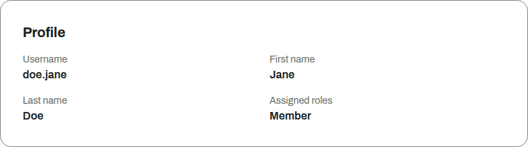

*Account security* follows the profile, with two-factor authentication, sessions and your password.
Existing direct security links still reach that section.

You must enter the current password before changing it. After saving, Courtside ends every session,
including the one you are using. Sign in with the new password.

You can also end one session or all sessions. If you signed in more than five minutes ago,
Courtside asks for your password before ending other sessions. With two-factor authentication it
also asks for a second proof. You can end the current session without that extra check.

The board can correct errors in your name or username from the people administration.

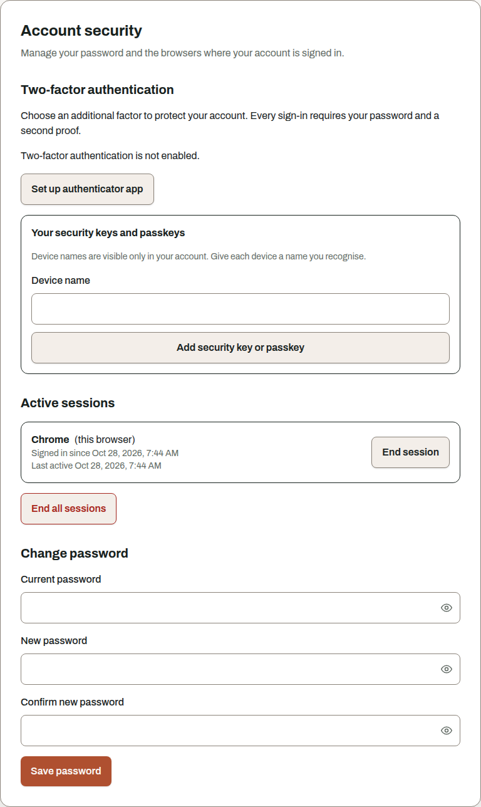

### Two-factor authentication

A second factor protects your account even when someone knows your password. Setting one up is
voluntary. You can use an authenticator app, a security key or a passkey. If you signed in more
than five minutes ago, Courtside asks for your password again before any change. Once a factor is
set up, it also asks for a code or your security key.

To set up an authenticator app:

1. Select *Set up authenticator app*.
2. Scan the QR code with the app or enter the *Setup key*.
3. Enter the current six-digit code and select *Confirm authenticator*.

Only the confirmation activates the app. *Replace authenticator app* sets up a new app, and the
previous one keeps working until you confirm the new one.

To add a security key or passkey:

1. Enter a *Device name* you will recognise.
2. Select *Add security key or passkey*.
3. Confirm your browser's request, for example with a PIN or fingerprint.

Courtside receives only the signed result, never your fingerprint. Only you see device names. You
can add several devices, rename each one and remove them one by one. Security keys need a supported
browser and a secure connection configured by your club. If either is missing, Courtside explains
it in this place, and the authenticator app remains available.

### Recovery codes

Your first factor comes with recovery codes. They appear exactly once, in the *Save your recovery
codes* dialog. Keep them somewhere secure outside the device, such as a password manager or on
paper. Each code replaces your second factor exactly once. Account security shows how many codes
remain. *Generate new recovery codes* replaces every previous code.
Select *Codes saved, continue to sign-in* only after you have saved them.

### Changing or removing factors

Every change to your factors ends all sessions, including the current one. Courtside emails you
about security-relevant changes. The message names no device and no code.
*Remove authenticator app*, *Remove device* and *Disable two-factor authentication* ask you to
confirm first. After disabling, only your password protects your account.

The board sees only whether your account has a second factor. It sees none of your devices, codes
or device names. A password the board resets leaves your factors unchanged.
