# Handbuch für Mitglieder

Dieses Handbuch erklärt die Funktionen, die du als Mitglied brauchst. Die Namen von Schaltflächen
und Menüpunkten stehen *kursiv*. Öffnungszeiten, Fristen und Obergrenzen legt dein Verein fest.

## Der Platzplan ist öffentlich

Die Startseite zeigt den Platzplan auch ohne Anmeldung. Auf einem großen Bildschirm siehst du eine
Woche, auf einem schmalen Bildschirm einen Tag. Ohne Anmeldung steht über dem Plan ein Hinweis. Zum
Buchen wählst du dort *Anmelden*.

1. Wähle unter *Datum auswählen* einen Tag, um direkt dorthin zu springen, auch über Wochen hinweg.
2. Wähle *Vorherige Woche* oder *Nächste Woche*, um schrittweise zu blättern.
3. Wähle *Zur aktuellen Zeit*, um zum heutigen Tag zurückzukehren. Das geht von jedem Zeitraum aus.
4. Lies in der Legende, ob ein Zeitraum **Frei**, **Belegt**, **Deine Buchung**,
   **Nicht verfügbar** oder **Vergangen** ist.

An geschlossenen Tagen zeigt Courtside kein Raster, an einem Feiertag steht dessen Name darüber.
Ein gesperrter Platz zeigt in seiner Spalte *Gesperrt*. Liegt eine Buchung außerhalb der Öffnungszeiten,
etwa weil der Verein sie später geändert hat, bleibt sie im Plan sichtbar. Die übrigen Plätze in
diesen Zeilen stehen auf *Geschlossen*. Bei fremden Buchungen siehst du entweder die
Buchungsart oder den neutralen Text *Belegt*. Das stellt der Verein für jede Buchungsart ein. Die
Anzahl der Teilnehmenden ist öffentlich, ihre Namen sind es nicht. Namen siehst du nur bei deinen
eigenen Buchungen.

Auf einem schmalen Bildschirm zeigt eine Buchung nur ein Kürzel ihrer Buchungsart. Die Legende
nennt zu jedem Kürzel den vollen Namen. Deine eigenen Buchungen tragen zusätzlich ein Personensymbol.

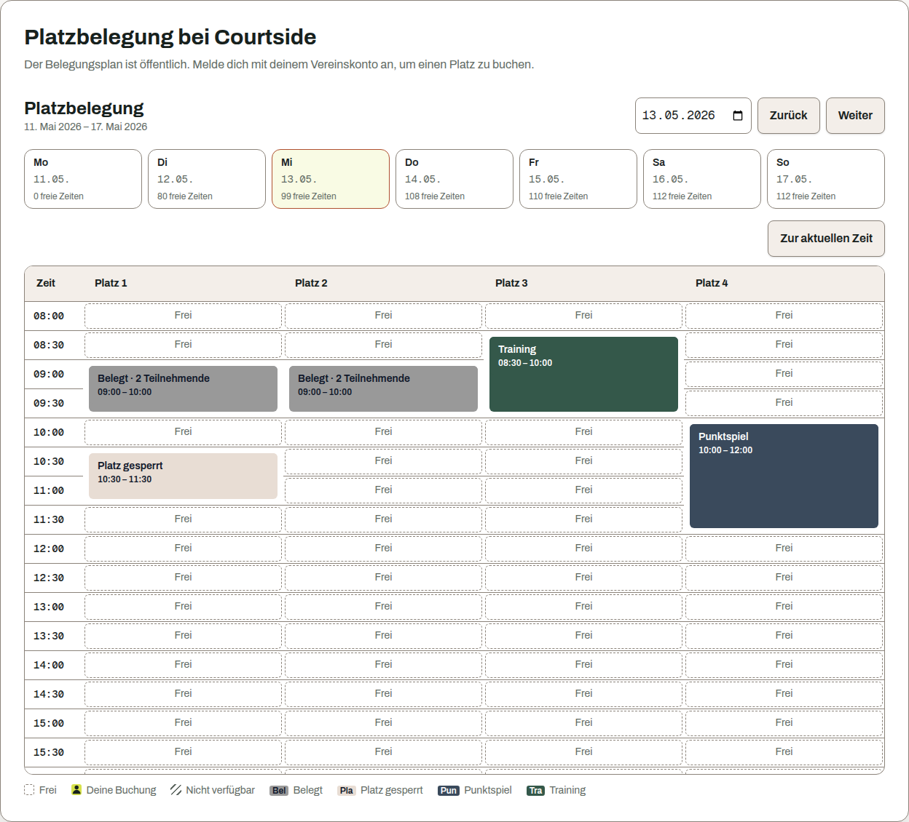

## Anmelden

Der Vorstand legt dein Konto an. Courtside schickt dir zuerst eine Willkommensnachricht und danach
in einer eigenen E-Mail den Benutzernamen und ein Einmalpasswort. Niemand im Vorstand sieht oder
bestimmt dieses Passwort.

1. Wähle *Anmelden*.
2. Gib deinen Benutzernamen und dein Passwort ein.
3. Wähle erneut *Anmelden*.

Hast du einen Link auf eine Seite in Courtside geöffnet, etwa auf eine Buchung, bringt dich Courtside
nach der Anmeldung genau dorthin. Das gilt auch, wenn du vorher dein Einmalpasswort ersetzen musst.
Endet deine Sitzung, während du eine Seite offen hast, kehrst du nach der nächsten Anmeldung
ebenfalls dorthin zurück.

Prüfe bei einer Ablehnung zuerst die Eingabe. Vielleicht sind die Zugangsdaten abgelaufen oder die
E-Mail ist nicht angekommen. Nutze dann *Passwort oder Benutzername vergessen?*. Bei einem
deaktivierten Konto kann nur der Vorstand helfen.

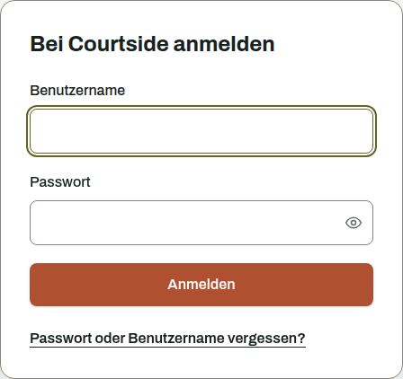

## Passwort oder Benutzername vergessen

Die Wiederherstellung funktioniert ohne Anmeldung. Auf der Seite stehen drei getrennte Formulare.

### Code anfordern

1. Gib deinen Benutzernamen ein.
2. Wähle *Code zuschicken*.
3. Öffne die E-Mail mit dem achtstelligen Code.

Das bisherige Passwort bleibt gültig. Offene Sitzungen bleiben angemeldet.

### Code einlösen

1. Gib den Code aus der E-Mail ein.
2. Lege ein neues Passwort fest.
3. Wähle *Passwort setzen*.

Danach gilt nur noch das neue Passwort. Courtside beendet alle offenen Sitzungen des Kontos. Ein
abgelehntes Passwort verbraucht den Code nicht. Groß- und Kleinschreibung sowie Bindestriche im
Code spielen keine Rolle. Abgelaufene Codes musst du neu anfordern.

### Benutzernamen anfordern

Gib deine E-Mail-Adresse ein und wähle *Benutzernamen zuschicken*. Courtside sendet für jedes Konto
an dieser Adresse eine eigene Nachricht. Passwörter bleiben unverändert.

Courtside antwortet immer gleich, auch wenn der Benutzername oder die Adresse unbekannt ist. So
kann niemand über das Formular nach Konten suchen. Wenn keine E-Mail eintrifft, prüfe den
Benutzernamen und das richtige Postfach. Danach hilft der Vorstand weiter.

Zu viele Versuche führen zu einer Wartezeit. Bei Anmeldung und Code-Eingabe zählt die gemeinsame
Internetverbindung. Beim Anfordern zählt zusätzlich der eingegebene Benutzername oder die Adresse.
Andere Personen im selben Netz können deshalb dieselbe Begrenzung erreichen. Dein bestehendes
Passwort bleibt davon unberührt.

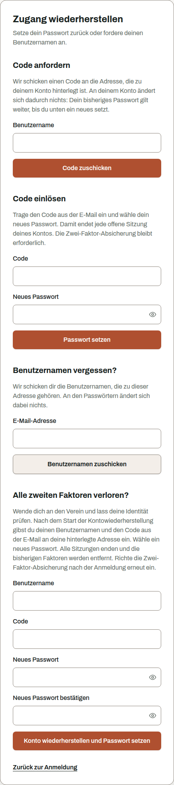

## Das Einmalpasswort ersetzen

Ein Einmalpasswort gilt nur für den ersten Zugang oder für ein vom Vorstand zurückgesetztes Konto.
Nach der Anmeldung führt Courtside dich direkt zu *Einmalpasswort ersetzen*. Andere Funktionen
bleiben gesperrt, bis du ein eigenes Passwort gesetzt hast.

1. Gib das neue Passwort zweimal ein.
2. Wähle *Passwort speichern*.
3. Melde dich mit dem neuen Passwort erneut an.

Das Passwort muss 12 bis 256 Zeichen lang sein. Courtside lehnt häufig verwendete Passwörter ab.
Das gilt auch für Passwörter mit deinem Namen, Benutzernamen, deiner E-Mail-Adresse, dem
Vereinsnamen oder einem vom Verein gesperrten Begriff. Das neue Passwort darf außerdem nicht dem
bisherigen oder dem ausgestellten Passwort entsprechen.

Courtside prüft über einen öffentlichen Dienst, ob das Passwort aus einem bekannten Datenleck
stammt. Dabei verlassen nur die ersten fünf Zeichen eines Prüfwerts die Instanz. Der Dienst erhält
das Passwort nicht. Ist die Prüfung nicht erreichbar, speichert Courtside das Passwort nicht.
Versuche es später erneut.

Das Auge in einem Passwortfeld zeigt, was du getippt hast. Ein zweiter Klick verdeckt es wieder.

Ist das Einmalpasswort bereits abgelaufen, fordere über die Anmeldeseite einen Code an. Mit diesem
Code kannst du selbst ein neues Passwort setzen.

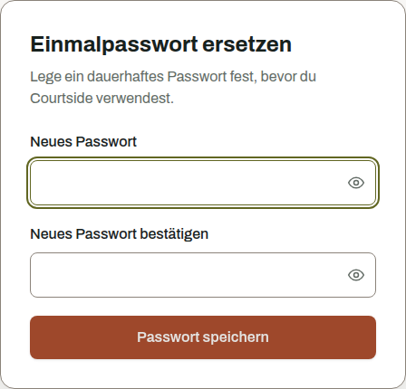

## Eine Buchung anlegen

1. Wähle im Platzplan eine freie Zelle. Sie bestimmt Platz und Beginn.
2. Wähle eine erlaubte **Dauer**.
3. Wähle die **Art der Buchung**.
4. Füge bei Bedarf Mitglieder hinzu.
5. Öffne *Weitere Angaben*, wenn du Gäste, Platzfüller oder eine Notiz eintragen möchtest.
6. Wähle *Jetzt buchen*.

Normale Mitgliedskonten buchen den gewählten Platz. Konten mit zusätzlichen Rollen können mehrere
Plätze auswählen, zum Beispiel für ein Training.

Die Datenbank prüft beim Speichern, ob der Platz noch frei ist. Hat jemand denselben Zeitraum kurz
zuvor gebucht, lehnt Courtside deine Buchung ab. Eine Doppelbelegung entsteht nicht.

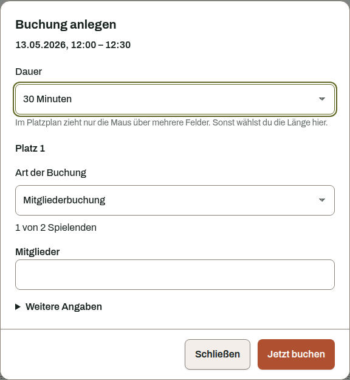

## Was eine Buchungsart bedeutet

Eine Buchungsart legt fest, wie eine Belegung behandelt wird. Das kann ein Spiel, ein Training, ein
Punktspiel oder eine Sperrung sein.

Die Buchungsart bestimmt:

* wie viele Personen eingetragen werden können,
* ob Gäste erlaubt sind,
* ob die Buchung gegen deine Obergrenze offener Buchungen zählt,
* welche Rollen diese Buchungsart verwenden dürfen.

Der Vorstand richtet die Buchungsarten ein. Im Buchungsdialog erscheinen nur die Arten, die du
verwenden darfst.

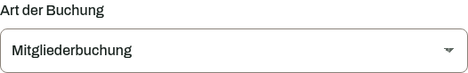

## Mitspieler und Gäste

Der Buchungsdialog zeigt, wie viele Spielerplätze bereits belegt sind.

* Suche **Mitglieder** nach ihrem Namen und füge sie hinzu. Jedes Mitglied kann in einer Buchung
  nur einen Spielerplatz belegen. Als buchende Person hast du schon einen Platz, deshalb bietet die
  Suche dich nicht an.
* Trage **Gäste** unter *Weitere Angaben* namentlich ein. Das Feld erscheint nur bei passenden
  Buchungsarten.
* Wähle unter ***Was mitspielt*** einen Platzfüller, zum Beispiel eine Ballmaschine oder einen
  Eintrag "Spielpartner gesucht". Courtside meldet, wenn zur gewählten Zeit kein Exemplar frei ist.

Eingetragene Mitglieder erhalten eine E-Mail. Sie müssen der Eintragung nicht zustimmen und können
sich selbst wieder austragen.

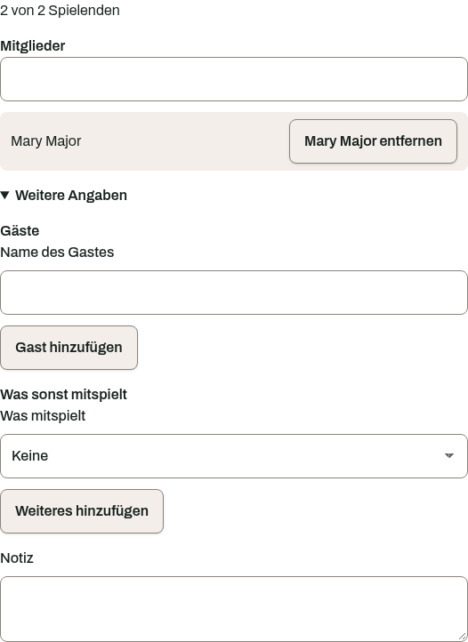

## Als Mitspieler eingetragen

Öffne *Meine Buchungen* und gehe zu **Als Mitspieler eingetragen**. Dort stehen Buchungen, die
andere Mitglieder mit deinem Namen angelegt haben.

Mit *Austragen* entfernst du dich aus der Buchung. Die Buchung bleibt bestehen. Courtside
benachrichtigt die Person, die sie angelegt hat. Eine stornierte Buchung bleibt als storniert
stehen und bietet kein Austragen an.

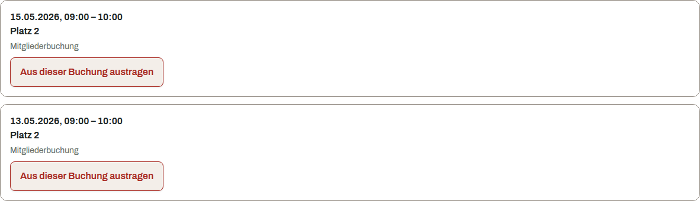

## Einen Mitspieler suchen

Steht in deiner Buchung der Platzfüller "Spielpartner gesucht", zeigt *Meine Buchungen* bei ihr
**Mitspieler suchen**. Damit bietest du diesen Platz anderen Mitgliedern an. Mit **Suche beenden**
nimmst du das Angebot zurück. Eine Serie und eine Buchung, die schon begonnen hat, bieten keinen
Platz an.

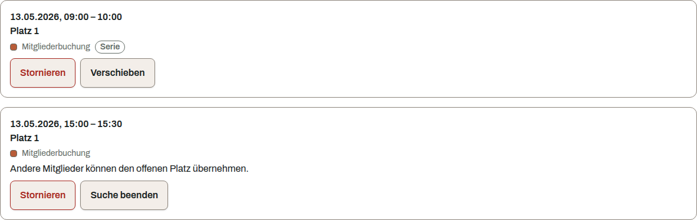

Andere Mitglieder sehen angebotene Plätze in *Meine Buchungen* unter **Offene Plätze**: Zeit, Platz
und Buchungsart, aber keinen Namen. Angezeigt wird ein Platz nur Mitgliedern, die diese Buchungsart
buchen dürfen und noch nicht mitspielen. Wer **Platz übernehmen** wählt, steht danach an Stelle des
Platzfüllers in der Buchung. Den Platz übernimmt nur ein Mitglied, auch wenn mehrere gleichzeitig
zugreifen.

Du erfährst per Nachricht, wer deinen Platz übernommen hat. Das Mitglied erfährt, wann und wo es
spielt. Beide Nachrichten lassen sich abschalten. Wird die Buchung storniert oder beginnt sie, endet
das Angebot.

## Wenn eine Regel die Buchung ablehnt

Die Mitgliedsart bestimmt, welche Buchungsregeln für dich gelten. Courtside zeigt alle erkannten
Verstöße gleichzeitig am jeweiligen Feld an.

| Meldung | Bedeutung |
|---|---|
| An diesem Tag ist die Anlage geschlossen | Für den Tag ist keine Öffnungszeit hinterlegt |
| Buchungen sind nur zwischen zwei Uhrzeiten möglich | Die Buchung liegt außerhalb der Öffnungszeit |
| Platz 2 ist bis zu einem Datum gesperrt | Der Verein hat den Platz an diesem Tag gesperrt |
| Mit deiner Mitgliedsart kannst du nur zwischen zwei Uhrzeiten buchen | Deine Mitgliedsart darf nur einen Teil der Öffnungszeit buchen |
| Buchungen beginnen im Minutenraster | Der Beginn passt nicht in das Raster des Vereins |
| Die Dauer muss ein Vielfaches der Rasterlänge sein | Die Dauer passt nicht in das Raster |
| Du kannst höchstens eine bestimmte Zahl von Tagen im Voraus buchen | Der erlaubte Vorlauf ist überschritten |
| Eine Buchung darf höchstens eine bestimmte Zahl von Minuten dauern | Die gewählte Dauer ist zu lang |
| Eine Buchung muss mindestens eine bestimmte Zahl von Minuten dauern | Die gewählte Dauer ist zu kurz |
| Du kannst pro Woche höchstens eine bestimmte Zahl von Stunden buchen | Mit dieser Buchung hättest du in der Woche von Montag bis Sonntag mehr Stunden gebucht, als deine Mitgliedsart erlaubt |
| Du hast die erlaubte Zahl offener Buchungen erreicht | Du musst zuerst eine offene Buchung beenden oder stornieren |
| Du musst eine bestimmte Zahl von Minuten vor Beginn stornieren | Die Stornierungsfrist ist abgelaufen |
| Eine Buchung darf nicht in der Vergangenheit beginnen | Der gewählte Beginn liegt in der Vergangenheit |
| Platzbuchungen sind für dich nicht freigegeben | Deine Mitgliedsart darf selbst keine Plätze buchen |
| Du bist in den letzten Tagen zu einer Zahl von Buchungen nicht erschienen | Der Verein nimmt keine Buchung an, bis der Vorstand die Nichterscheinen aufhebt |

Die konkrete Zahl steht in der Meldung. Ändere die markierten Angaben und sende die Buchung erneut.

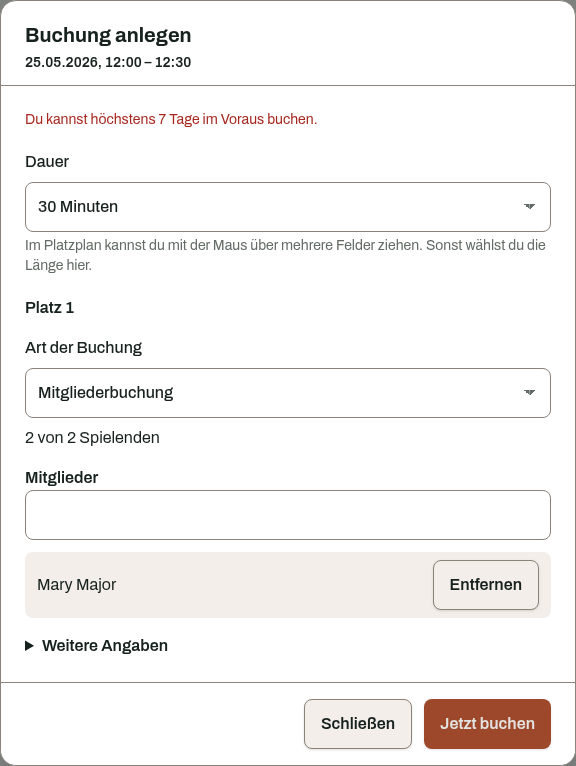

## Stornieren

1. Öffne *Meine Buchungen*.
2. Wähle bei einer bevorstehenden Buchung *Stornieren*.
3. Bestätige die Stornierung.

Courtside gibt den Platz sofort frei. Ist die Stornierungsfrist abgelaufen, bleibt die Buchung
bestehen und Courtside nennt dir die geltende Frist.

Bis zu ihrem Termin steht die stornierte Buchung im eingeklappten Abschnitt der stornierten
Buchungen unter den bevorstehenden. So verdrängt sie keine Buchung, die noch gilt. Danach findest du
sie bei den vergangenen Buchungen.

Wer in der Buchung als Mitspieler eingetragen ist, erfährt von der Stornierung. Storniert der Verein
deine Buchung, erfährst du es ebenfalls. Hat der Verein einen Grund gewählt, nennt die Nachricht
ihn. Sonst erfährst du ihn beim Verein.

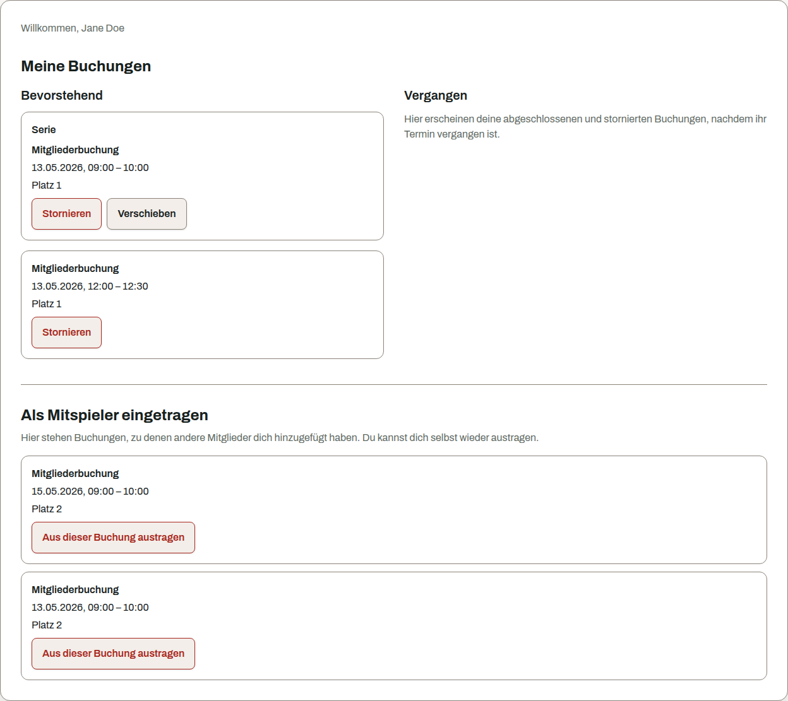

### Einchecken

Erfasst dein Verein die Anwesenheit, checkst du unter *Meine Buchungen* ab 15 Minuten vor Beginn bis
zum Ende deiner Buchung mit **Einchecken** ein. Hat der Verein eine Freigabezeit eingestellt und
niemand checkt bis dahin ein, storniert Courtside die Buchung und gibt den Platz frei. Sie steht
dann als freigegeben unter deinen stornierten Buchungen. Du und alle Mitspieler der Buchung bekommen
darüber eine Nachricht. Einchecken kann nur, wer gebucht hat.

## Auf einen belegten Platz warten

Ist ein Platz zu deiner Wunschzeit belegt, kannst du dich auf seine Warteliste setzen.

1. Wähle im Platzplan die belegte Zeit.
2. Wähle Buchungsart und Mitspieler wie bei einer Buchung.
3. Wähle *Auf die Warteliste setzen*.

Courtside prüft dabei dieselben Regeln wie bei einer Buchung. Für jeden Platz und jede Zeit gibt es
eine eigene Warteliste. Wer sich zuerst einträgt, kommt zuerst dran.

Wird der Platz frei, reserviert Courtside ihn für das erste Mitglied auf der Warteliste. Dein Angebot
steht unter *Benachrichtigungen* und unter *Meine Buchungen*, per E-Mail nur, wenn du E-Mail gewählt
hast. Die Reservierung gilt so lange, wie der Verein es eingestellt hat, höchstens bis zum Beginn der
Zeit. Wählst du *Buchen*, wird daraus deine Buchung mit den eingetragenen Mitspielern. Lehnst du ab
oder läuft die Zeit ab, geht der Platz an das nächste Mitglied. Darfst du den Platz inzwischen nicht
mehr buchen oder lehnt dein Mailserver die Nachricht mit dem Angebot ab, überspringt Courtside dich.
Belegt der Verein den Platz selbst, etwa für eine Sperrung, endet dein Angebot.

Unter *Meine Buchungen* siehst du nur deine eigenen Einträge. Wer sonst wartet und an welcher Stelle
du stehst, zeigt Courtside niemandem. Du kannst eine Warteliste jederzeit verlassen. Buchst du den
Platz selbst oder beginnt die Zeit, endet dein Eintrag. Auf demselben Platz kannst du nur auf eine
Zeit zugleich warten, die sich mit einer anderen überschneidet. Du kannst höchstens 20 Einträge haben,
deren Zeit noch nicht vorbei ist. Dazu zählen auch Einträge, die du verlassen hast oder die ohne
Buchung geendet haben. Ein Eintrag, aus dem deine Buchung wurde, zählt nicht, solange sie den Platz
zu dieser Zeit noch belegt.

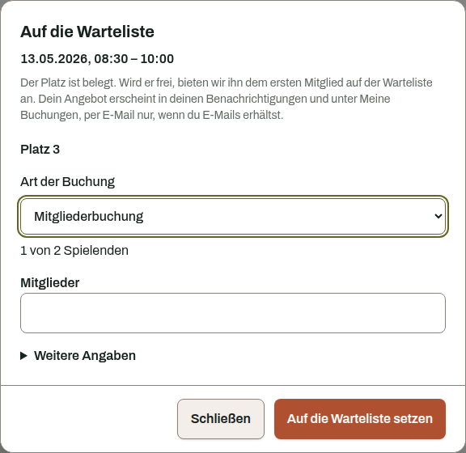

## Serientermine

Konten, deren Rolle eine aktive Buchungskarte ohne Spielerliste erlaubt, können unter *Verwaltung → Vereinstermine* Serien anlegen. Eine Serie legt
gewöhnliche Buchungen nach einem Plan an. Du bestimmst den ersten Termin, die Uhrzeit, Dauer,
Wochentage, den Abstand in Wochen und das Ende der Serie.

Beachte dabei:

* Bereits belegte Termine werden übersprungen. Die übrigen Termine legt Courtside an.
* Beim Stornieren oder Verschieben kannst du *Nur dieser Termin*, *Dieser und folgende Termine*
  oder *Ganze Serie* wählen.
* Vor einer Verschiebung zeigt Courtside die betroffenen Termine und mögliche Konflikte.
* Serien enthalten keine Spielerlisten. Im Platzplan erscheinen sie als belegte Zeit.
* Nach dem Anlegen bekommst du eine Zusammenfassung der Serie statt einer Bestätigung pro Termin.
* Storniert oder verlegt der Verein Termine deiner Serie, bekommst du eine Nachricht über alle
  betroffenen Termine.

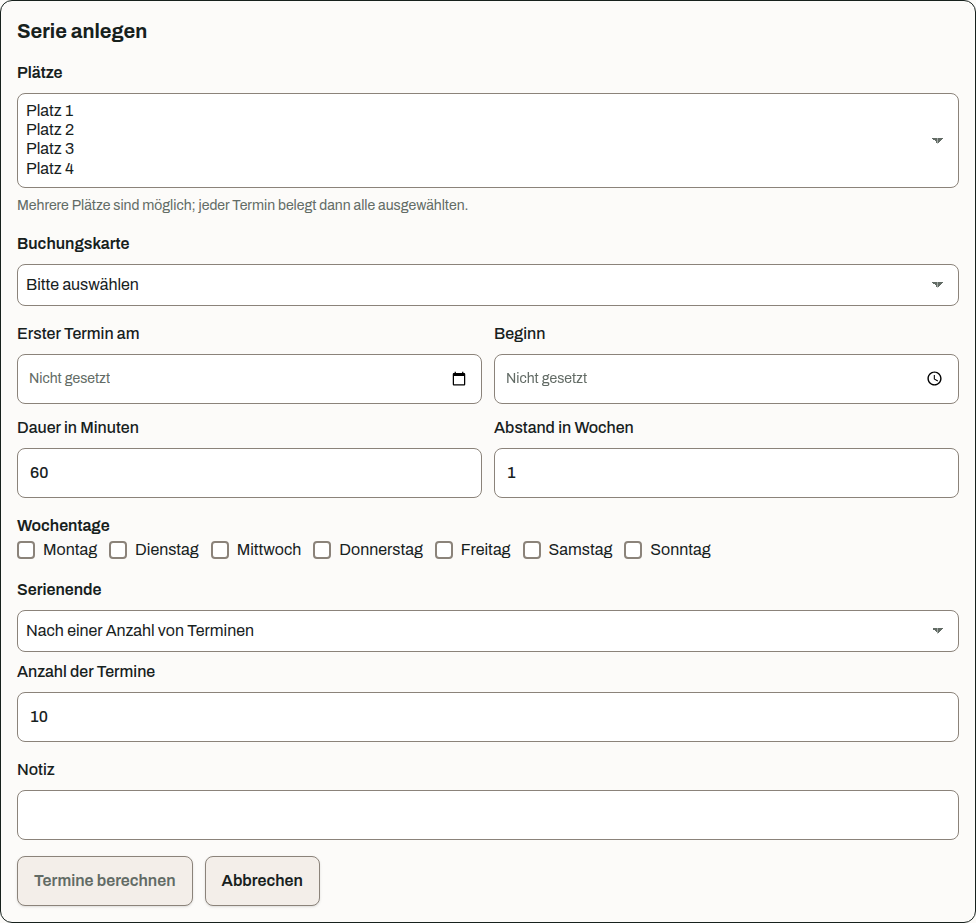

## Wenn sich unter deiner Buchung etwas ändert

Eine spätere Änderung kann deine Buchung betreffen. Beispiele sind ein deaktivierter Platz, eine
stillgelegte Buchungsart oder verkürzte Öffnungszeiten.

Courtside nennt dir den Grund unter *Benachrichtigungen* und per E-Mail, wenn du E-Mail gewählt
hast. Die Buchung wird dadurch nicht automatisch storniert. Der Verein entscheidet, wie er mit ihr umgeht.

## Benachrichtigungen

Unter *Benachrichtigungen* stehen alle Nachrichten, die Courtside dir geschickt hat, die neueste
zuerst. Jeder Eintrag zeigt, wann er kam, worum es geht und ob du ihn schon gelesen hast. Neue
Einträge sind mit *Neu* markiert. Über den Link darunter kommst du zur betroffenen Buchung oder zu
deiner Kontosicherheit. Mit *Als gelesen markieren* oder dem Link markierst du einen Eintrag als
gelesen. Hier siehst du nur Nachrichten an dich, auch ohne E-Mail-Adresse. Wie viele Einträge
ungelesen sind, zeigt die Zahl neben *Benachrichtigungen* im Menü.

Darunter wählst du, was du bekommst. Du kannst diese Nachrichten abwählen:

* Buchungsbestätigung,
* Erinnerung vor der Buchung,
* Nachricht über den Austritt einer Person aus deiner Buchung,
* Nachricht, dass die buchende Person eine Buchung storniert hat, in der du eingetragen warst,
* Zusammenfassung einer neuen Serie.

Eine abgewählte Nachricht bekommst du gar nicht mehr, weder hier noch per E-Mail.

Diese Nachrichten sendet Courtside immer:

* Zugangsdaten für ein neues oder zurückgesetztes Konto,
* Mitteilung über deine Eintragung als Mitspieler,
* Mitteilung über eine Änderung, die deine Buchung betrifft,
* Mitteilung, dass der Verein eine Buchung storniert hat, die dich betrifft,
* Mitteilung, dass der Verein Termine deiner Serie storniert oder verlegt hat,
* Angebot von einer Warteliste, auf der du stehst. Wer sie verlässt, bekommt keines mehr.

Getrennt davon entscheidest du, ob du zusätzlich eine E-Mail bekommst. Ohne E-Mail stehen deine
Nachrichten weiter hier. Von deiner Eintragung als Mitspieler, einer Änderung an deiner Buchung oder
einer Stornierung durch den Verein erfährst du dann nur hier. Zugangsdaten, deinen Benutzernamen und
Codes zum Zurücksetzen schickt Courtside immer per E-Mail, denn dafür bist du nicht angemeldet.

Hat dein Verein die Adresse von Courtside eingerichtet, endet eine E-Mail zu einer Buchung mit einem
Link. Er führt zur Buchung oder zu *Meine Buchungen*, ein Angebot von der Warteliste zu deinem
Platz auf der Warteliste. Der Kalendereintrag einer Bestätigung trägt denselben Link. Die
Willkommensnachricht endet mit einem Link zur Startseite von Courtside.

In E-Mails mit Zugangsdaten, deinem Benutzernamen oder einem Code zum Zurücksetzen setzt Courtside
keinen Link. Manche Mailprogramme machen trotzdem etwas klickbar, etwa einen Vereinsnamen, der wie
eine Adresse aussieht. Folge dort keinem Link, sondern öffne Courtside über die Adresse, die du
kennst. Eigene Texte deines Vereins können von dieser Regel abweichen.

Speichere die Auswahl. Die Einstellung gilt nur für künftige Nachrichten.

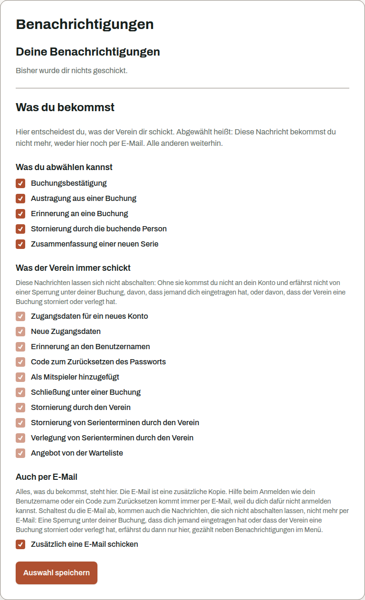

## Dein Konto

Öffne *Kontosicherheit*, um dein Passwort und deine Sitzungen zu verwalten.

Beim Ändern des Passworts musst du das aktuelle Passwort eingeben. Nach dem Speichern beendet
Courtside alle Sitzungen, auch die gerade verwendete. Melde dich danach mit dem neuen Passwort an.

Du kannst außerdem eine einzelne Sitzung oder alle Sitzungen beenden. Bei älteren Anmeldungen fragt
Courtside vor dem Beenden anderer Sitzungen erneut nach deinem Passwort. Die aktuelle Sitzung
kannst du ohne diese Rückfrage beenden.

Fehler in deinem Namen oder Benutzernamen korrigiert der Vorstand in der Personenverwaltung.

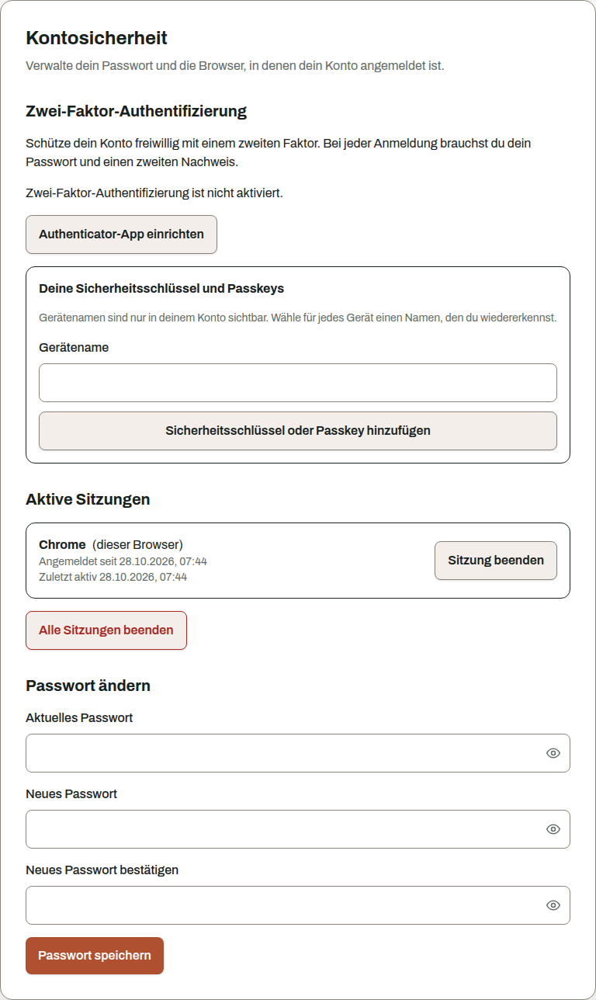
